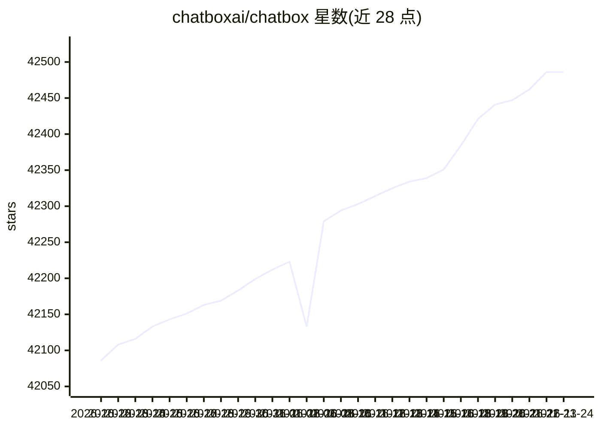

# chatboxai/chatbox

⭐ 42,508 · TypeScript · GPL-3.0 · 推送 2026-11-18 · [GitHub](https://github.com/chatboxai/chatbox) · [官网](https://chatboxai.app?utm_medium=github) · 组织维护

**面向个人用户的桌面 LLM 聊天客户端，接入多家模型**

Chatbox 社区版（GPLv3）是一款跨平台桌面 AI 聊天客户端，支持 Windows/macOS/Linux 安装包及 iOS/Android 应用和网页版。用户在设置中配置模型服务商（OpenAI、Claude 等）的 API 后即可对话；支持 DALL·E-3 图像生成、Markdown/LaTeX/代码高亮渲染、流式回复、提示词库、本地数据存储与团队共享 API 资源。提供 9 种语言界面。另有 Pro 版仓库与本仓库双向同步代码。

## 筛选速览

| 维度 | 判定 | 备注 |
|---|---|---|
| AI 角色 | `ai-ecosystem` | LLM/agent 周边工具 |
| 许可风险 | `viral` | GPL-3.0 |
| 部署形态 | `desktop` | 安装包/桌面程序 |
| 模型依赖 | local-ok | 支持本地模型 |
| 硬件要求 | — | 无带数字的原话,不猜 |
| 安装摩擦 | `low` | 无编译、无系统依赖或容器化 |
| 成熟度 | — | 结构信号不足 |

## 动量与使用信号

- 维护:`active` — 距上次 push 23.7 天,年发版 17,71 位贡献者
- 涨星:近 1 天 **+15**(自 20261016 起算)
- 下载:GitHub Release 附件 累计 514,792(65 个 release)
- 平台:WINDOWS / MACOS / LINUX / ANDROID / IOS · 协议:OPENAI-API / OLLAMA

## 能力要点

- 接入多家 LLM 服务商（OpenAI、Azure OpenAI、Claude、Gemini、Ollama、ChatGLM-6B）
- 支持 DALL·E-3 图像生成与流式回复
- 本地数据存储，界面支持 9 种语言
- Windows/macOS/Linux 安装包与 iOS/Android/Web 多端可用

## 适用场景

- 在桌面端统一使用多个模型服务商的 API 进行对话
- 用 DALL·E-3 在聊天中生成图像
- 团队内共享 OpenAI API 资源协作
- 数据存本地、注重隐私的个人 AI 助手使用

## 场景标签

`聊天机器人` `AI 助手` `图像生成` · 领域:对话与助手

## 证据(README 行号)

> L7:  Your Ultimate AI Copilot on the Desktop. Chatbox is a desktop client for ChatGPT, Claude and other LLMs, available 
> L105: - **Support for Multiple LLM Providers**
> L91: 3. Configure your AI provider (OpenAI, Claude, etc.) in settings

## 星数曲线

2026-10-22 42,086 → 2026-11-24 42,486（+400）

---
*卡片 v1 · prompt 1.4 · 生成 2026-11-22 · 置信度 high · 依据 README sha `bf2bc40bf760` · [字段定义](../../DATASET.md)*
