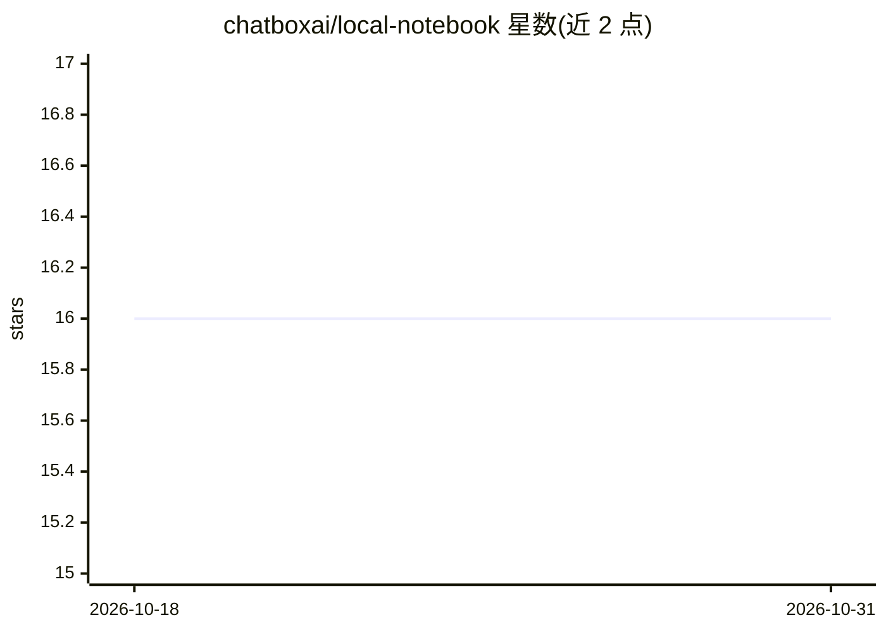

# chatboxai/local-notebook

⭐ 16 · Python · Apache-2.0 · 推送 2026-07-01 · [GitHub](https://github.com/chatboxai/local-notebook) · 组织维护 · 中文 README

**全本地部署的类 NotebookLM 长文档问答应用，答案带块级溯源**

面向长篇非结构化文档的问答应用：后端 FastAPI、前端 Vue 3、向量库与文件存储均可本地运行，支持接入 OpenAI 兼容 API（含 Ollama、vLLM 等本地服务），也可用云端 API。答案提供块级引用，链接到页码与段落位置，音频支持时间戳。架构面向多租户扩展（SQLAlchemy、ARQ 后台任务）。通过 Docker Compose 一键启动，首次构建约 10-25 分钟；切换 Embedding 模型会使已有索引失效需重建。

## 筛选速览

| 维度 | 判定 | 备注 |
|---|---|---|
| AI 角色 | `ai-native` | 本体是模型或模型工具 |
| 许可风险 | `permissive` | Apache-2.0 |
| 部署形态 | `None` |  |
| 模型依赖 | local-ok | 支持本地模型 |
| 硬件要求 | — | 无带数字的原话,不猜 |
| 安装摩擦 | `low` | 无编译、无系统依赖或容器化 |
| 成熟度 | — | 结构信号不足 |

## 能力要点

- 全离线部署：后端/前端/向量库/文件存储均可本地运行
- 块级引用定位到页码与段落，音频支持时间戳
- Provider 无关：支持 OpenAI 兼容 API（私有/本地/商业）
- 可选本地服务：Embedding / MinerU / FunASR

## 适用场景

- 医疗、法律、合规等场景下对数百页私有文档做带溯源的问答
- 数据不出本机或内网的知识库问答
- 从单人本地应用演进为内网/企业多租户部署

## 场景标签

`文档问答` · 领域:知识与检索

## 证据(README 行号)

> L5: > **A fully local NotebookLM-style application for long, unstructured documents, with a codebase designed for multi-
> L27: - **Block-level citations**: answers link directly to page and paragraph positions, with timestamp support for audi
> L26: - **Fully offline-capable deployment**: backend, frontend, vector database, and file storage can run locally. LLMs 

## 星数曲线

2026-10-18 16 → 2026-10-31 16（+0）

---
*卡片 v1 · prompt 1.4 · 生成 2026-10-30 · 置信度 high · 依据 README sha `73d47835f790` · [字段定义](../../DATASET.md)*
