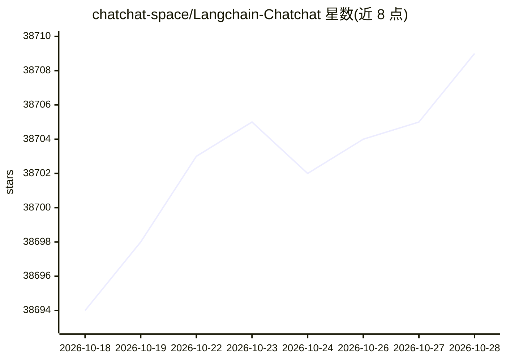

# chatchat-space/Langchain-Chatchat

⭐ 38,715 · Python · Apache-2.0 · 推送 2025-11-10 · [GitHub](https://github.com/chatchat-space/Langchain-Chatchat) · 组织维护 · 中文 README

**给开发者的可离线部署本地知识库 RAG 与 Agent 应用**

基于 Langchain 框架构建的本地知识库问答与 Agent 应用项目，原名为 Langchain-ChatGLM。支持接入 ChatGLM、Qwen、Llama 等语言模型，通过 Xinference、Ollama、LocalAI、FastChat 等模型部署框架加载本地模型，也可接入 OpenAI、Azure、Anthropic 等在线 API。提供知识库对话、文件对话、数据库对话、搜索引擎对话、文生图、多模态图片对话等功能，底层支持 BM25+KNN 等多种检索方式。以 Python 库（pip）形式安装，或通过 Docker 部署；不涉及模型微调与训练。

## 筛选速览

| 维度 | 判定 | 备注 |
|---|---|---|
| AI 角色 | `ai-native` | 本体是模型或模型工具 |
| 许可风险 | `permissive` | Apache-2.0 |
| 部署形态 | `self-host` | docker 或自建部署 |
| 模型依赖 | local-ok | 支持本地模型 |
| 硬件要求 | — | 无带数字的原话,不猜 |
| 安装摩擦 | `low` | 无编译、无系统依赖或容器化 |
| 成熟度 | — | 结构信号不足 |

## 动量与使用信号

- 维护:`declining` — 距上次 push 341.9 天,年发版 0,155 位贡献者
- 涨星:近 1 天 **+7**(自 20261016 起算)
- 安装:pypi 包 `langchain-chatchat` 月下载 254
- 平台:WEB · 协议:OPENAI-API / OLLAMA

## 能力要点

- 支持 Xinference、Ollama、LocalAI、FastChat 等本地模型部署框架接入
- 支持 BM25+KNN 等多种检索方式与本地知识库管理
- 以 Python 库形式安装（pip install langchain-chatchat），提供 Docker 镜像
- Agent 与工具调用，支持多模态图片对话与文生图

## 适用场景

- 在企业内网离线部署本地知识库问答系统
- 基于自有文档构建 RAG 问答与检索服务
- 通过 WebUI 或 API 进行知识库对话与文件对话

## 场景标签

`RAG` `文档问答` `Agent 框架` · 领域:Agent 开发

## 证据(README 行号)

> L11: 基于 ChatGLM 等大语言模型与 Langchain 等应用框架实现，开源、可离线部署的 RAG 与 Agent 应用项目。
> L29: ✅ 本项目支持市面上主流的开源 LLM、 Embedding 模型与向量数据库，可实现全部使用**开源**模型**离线私有部署**。与此同时，本项目也支持
> L122: 从 0.3.0 版本起，Langchain-Chatchat 提供以 Python 库形式的安装方式，具体安装请执行：

## 星数曲线

2026-10-18 38,694 → 2026-10-28 38,709（+15）

---
*卡片 v1 · prompt 1.4 · 生成 2026-10-18 · 置信度 high · 依据 README sha `1d82166df7d4` · [字段定义](../../DATASET.md)*
