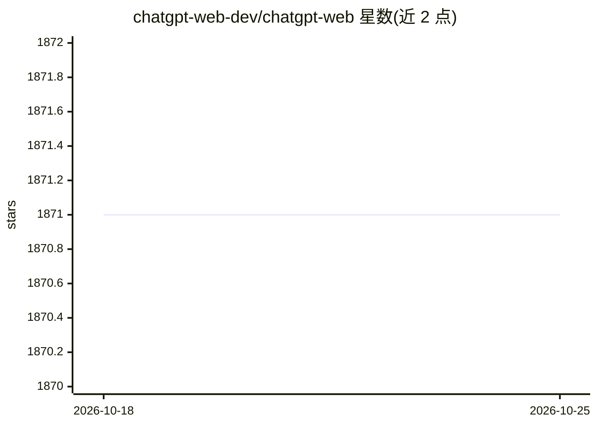

# chatgpt-web-dev/chatgpt-web

⭐ 1,871 · Vue · MIT · 推送 2026-03-04 · [GitHub](https://github.com/chatgpt-web-dev/chatgpt-web) · [官网](https://chatgpt-web.dev) · 组织维护 · 中文 README

**带用户系统与多后端的第三方 ChatGPT Web 前端**

Fork 自 Chanzhaoyu/chatgpt-web 的 Express + Vue3 对话应用，通过 OpenAI 官方 API 或 VLLM API 调用模型。面向需要多用户部署的搭建者：提供注册/登录/2FA、历史会话同步（MongoDB 存储）、用户管理、多 Key 随机、对话数量限制与兑换、每会话独立 Prompt、基于 Tavily API 的网络搜索、上下文窗口控制及 VLLM 深度思考开关。支持 Auth Proxy 模式对接 LDAP/OIDC/SAML 身份验证。支持 Docker、Docker Compose 与 Railway 部署，也可用 pnpm 手动运行，需 Node 20+。

## 筛选速览

| 维度 | 判定 | 备注 |
|---|---|---|
| AI 角色 | `ai-native` | 本体是模型或模型工具 |
| 许可风险 | `permissive` | MIT |
| 部署形态 | `self-host` | docker 或自建部署 |
| 模型依赖 | local-ok | 支持本地模型 |
| 硬件要求 | — | 无带数字的原话,不猜 |
| 安装摩擦 | `low` | 无编译、无系统依赖或容器化 |
| 成熟度 | — | 结构信号不足 |

## 能力要点

- 注册/登录/2FA 与用户管理、对话数量限制与兑换
- 基于 Tavily API 的实时网络搜索并整合进回答
- VLLM API 后端支持与按会话深度思考开关
- Auth Proxy 模式对接 LDAP/OIDC/SAML 单点登录

## 适用场景

- 给团队或社区搭建带账号体系的 ChatGPT 对话站
- 接入企业内部 LDAP/OIDC 账号系统实现 SSO 登录
- 用 VLLM 自建后端并对每会话控制上下文与深度思考

## 场景标签

`聊天机器人` · 领域:对话与助手

## 证据(README 行号)

> L59: 使用官方 `OpenAI API` 访问 `ChatGPT`：
> L61: `ChatGPTAPI` 使用 `gpt-4.1` 通过 `OpenAI` 官方 `API` 调用 `ChatGPT`（需要 API 密钥）。

## 星数曲线

2026-10-18 1,871 → 2026-10-25 1,871（+0）

---
*卡片 v1 · prompt 1.4 · 生成 2026-10-21 · 置信度 high · 依据 README sha `9d50aa2c5eeb` · [字段定义](../../DATASET.md)*
