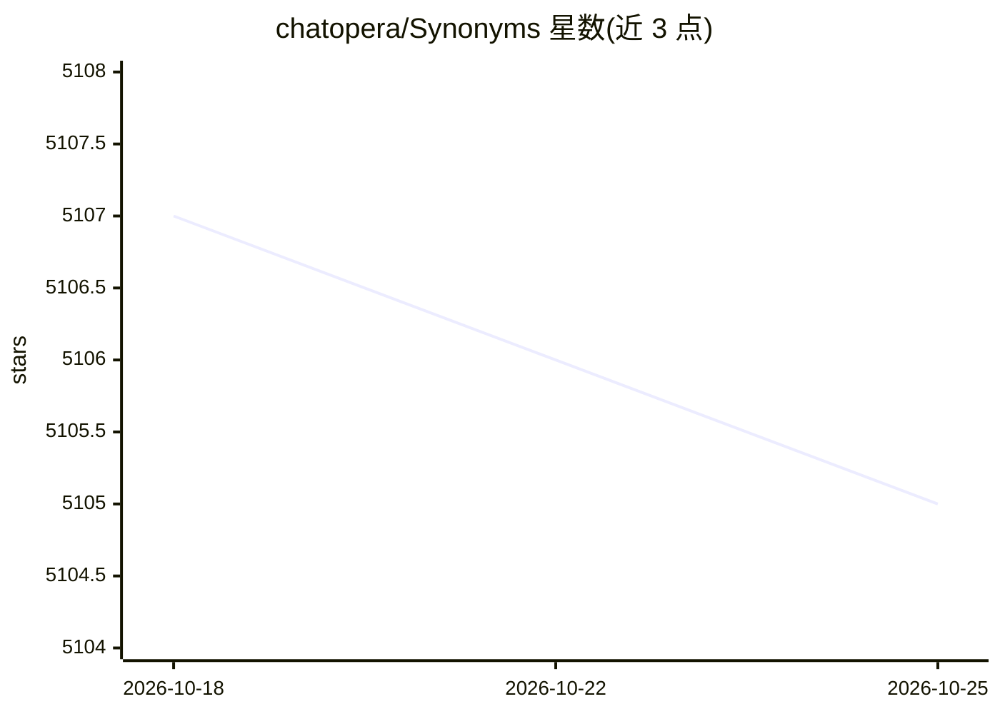

# chatopera/Synonyms

⭐ 5,106 · Python · NOASSERTION · 推送 2026-02-01 · [GitHub](https://github.com/chatopera/Synonyms) · [官网](https://bot.chatopera.com/) · 组织维护 · 中文 README

**中文近义词与相似度计算工具包，供 NLP 任务使用**

基于 word2vec 词向量（词表 435,729，语料来自 wikidata-corpus）的中文近义词 Python 工具包，提供近义词查询、句子相似度比较、分词、关键词提取、词/句向量与 BoW 接口，可用于 RAG、推荐、智能问答等任务。限制：机器学习模型包下载需从 Chatopera 证书商店购买 License 并配置环境变量，改用春松许可证 v1.0（README 另提及曾发布 MIT 证书）；不支持添加单词到词表。

## 筛选速览

| 维度 | 判定 | 备注 |
|---|---|---|
| AI 角色 | `ai-native` | 本体是模型或模型工具 |
| 许可风险 | `none` | NOASSERTION |
| 部署形态 | `library` | 以包/库形式分发 |
| 模型依赖 | — | README 未给出锁定关系 |
| 硬件要求 | — | 无带数字的原话,不猜 |
| 安装摩擦 | `low` | 无编译、无系统依赖或容器化 |
| 成熟度 | — | 结构信号不足 |

## 能力要点

- synonyms.nearby 返回按距离排序的近义词及 0-1 相似度分数
- 句子相似度比较 compare 与中文分词 seg、关键词提取 keywords 接口
- 词表容量 435,729，基于 word2vec 与 wikidata-corpus
- 可通过环境变量自定义词向量文件与分词主字典

## 适用场景

- 在我的 RAG 检索或推荐系统中做中文相似度计算
- 为智能问答或搜索引擎扩展中文近义词能力
- 调试时快速打印词语的近义词列表

## 场景标签

`语义搜索` · 领域:知识与检索

## 证据(README 行号)

> L9: `synonyms`可以用于自然语言理解的很多任务：RAG (Retrieval-Augmented Generation)，推荐算法，相似度计算，语义偏移，关键字提取，智能问答，自动摘要，搜索引擎等。
> L109: `synonyms.nearby(WORD [,SIZE])`返回一个元组，元组中包含两项：`([nearby_words], [nearby_words_score])`，`nearby_words`是 WORD 的近义词们，

## 星数曲线

2026-10-18 5,107 → 2026-10-25 5,105（-2）

---
*卡片 v1 · prompt 1.4 · 生成 2026-10-20 · 置信度 high · 依据 README sha `408e9c0a5f66` · [字段定义](../../DATASET.md)*
