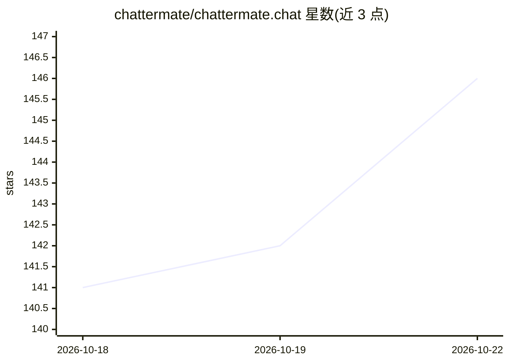

# chattermate/chattermate.chat

⭐ 146 · Python · Apache-2.0 · 推送 2026-10-20 · [GitHub](https://github.com/chattermate/chattermate.chat) · [官网](https://chattermate.chat) · 组织维护

**开源 AI 客服平台：AI 聊天机器人加人工接管**

面向企业的自托管 AI 客服平台：无代码 AI 聊天机器人处理常见咨询，复杂问题按营业时间与坐席状态转人工，共用一个收件箱。支持 OpenAI、Anthropic Claude、Google Gemini、Mistral、xAI Grok、DeepSeek、Groq 等多模型接入（自带 API key，可随时切换）。提供可视化拖拽工作流构建器、AI 工单调查（分级自主权限、只读带护栏的 SQL 连接器）、Shopify/WordPress/Slack/Jira 及 WhatsApp/Messenger/Telegram 等消息渠道集成。可使用免费托管服务或自行部署，Apache-2.0 许可。

## 筛选速览

| 维度 | 判定 | 备注 |
|---|---|---|
| AI 角色 | `ai-native` | 本体是模型或模型工具 |
| 许可风险 | `permissive` | Apache-2.0 |
| 部署形态 | `self-host` | docker 或自建部署 |
| 模型依赖 | locked-api |  |
| 硬件要求 | — | 无带数字的原话,不猜 |
| 安装摩擦 | `low` | 无编译、无系统依赖或容器化 |
| 成熟度 | — | 结构信号不足 |

## 能力要点

- 多模型 AI 提供商接入，可随时切换且无需改代码
- 可视化拖拽工作流构建器（分支逻辑、节点类型、版本控制）
- AI 工单：分级自主（L1-L3）、只读护栏 SQL 连接器与行级客户隔离
- 多种消息渠道、CRM 与 Jira/MCP 集成，共享收件箱

## 适用场景

- 电商/Shopify 店铺提供 24/7 AI 客服并在需要时转人工
- SaaS 或帮助台团队用知识库训练 AI 回答客户问题
- 把网站、WhatsApp、Slack 等多渠道客服汇入一个收件箱

## 场景标签

`聊天机器人` · 领域:对话与助手

## 证据(README 行号)

> L9: > **Open-source AI customer support platform with human handoff.** A no-code AI chatbot for 24/7 customer service au
> L17: ChatterMate is a **no-code AI customer support platform** that enables businesses to provide **24/7 customer servic
> L32: |🧠 **Multi-Model AI Support**|Choose your AI provider — **OpenAI**, **Anthropic (Claude)**, **Google Gemini**, **Mi

## 星数曲线

2026-10-18 141 → 2026-10-22 146（+5）

---
*卡片 v1 · prompt 1.4 · 生成 2026-10-22 · 置信度 mid · 依据 README sha `69b8da7053d7` · [字段定义](../../DATASET.md)*
