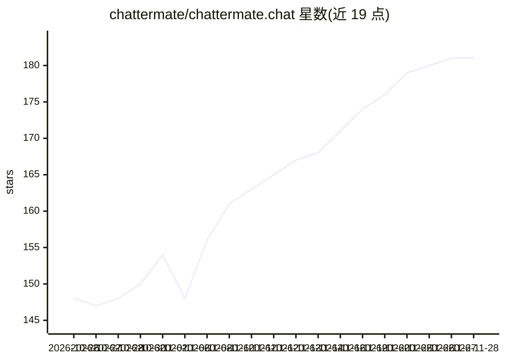

# chattermate/chattermate.chat

⭐ 181 · Python · Apache-2.0 · 推送 2026-11-27 · [GitHub](https://github.com/chattermate/chattermate.chat) · [官网](https://chattermate.chat) · 组织维护

**开源 AI 客服聊天机器人平台：人工接管与全渠道支持**

面向企业的开源 AI 客服平台：基于知识库 24/7 回答客户问题，复杂对话转人工的共享收件箱覆盖 Web、WhatsApp、Instagram、Messenger、Telegram、Slack、SMS 与邮件等多渠道。提供 AI 线索捕获（可推送 HubSpot/Pipedrive）、AI 生成帮助中心、MCP 工具调用、AI 工单（分阶段自治 L1-L3，SQL 连接器在代码层强制只读与行级隔离），并支持自选模型（OpenAI、Claude、Gemini、Mistral、Grok、DeepSeek、Groq 或任意 OpenAI 兼容端点）。可用免费托管服务或自托管，作为 Intercom、Zendesk 等的开源替代。

## 筛选速览

| 维度 | 判定 | 备注 |
|---|---|---|
| AI 角色 | `ai-native` | 本体是模型或模型工具 |
| 许可风险 | `permissive` | Apache-2.0 |
| 部署形态 | `self-host` | docker 或自建部署 |
| 模型依赖 | local-ok | 支持本地模型 |
| 硬件要求 | — | 无带数字的原话,不猜 |
| 安装摩擦 | `low` | 无编译、无系统依赖或容器化 |
| 成熟度 | — | 结构信号不足 |

## 能力要点

- 人工接管共享收件箱，覆盖 WhatsApp/Instagram/Messenger/Slack/邮件等全渠道
- AI 工单分阶段自治（L1 调查/L2 提议/L3 关单），SQL 连接器结构化只读+行级隔离
- 接入任意 MCP 服务器（HTTP/SSE/stdio），Agent 可在对话中调用工具
- 自带模型（BYOM）：支持 OpenAI/Claude/Gemini/Mistral/Grok/DeepSeek/Groq 或任意 OpenAI 兼容端点

## 适用场景

- 电商/Shopify 店铺自动回答订单、物流、产品咨询
- 客服团队通过共享收件箱接管 AI 处理不了的对话
- 把知识库变成 AI 生成、SEO 友好的公开帮助中心
- 对话中自动捕获并qualify销售线索同步到 CRM

## 场景标签

`聊天机器人` · 领域:对话与助手

## 证据(README 行号)

> L11: > **Open-source AI customer support platform with human handoff.** ChatterMate is an open source AI chatbot that an
> L49: |🧠 **Multi-Model AI Support**|Choose your AI provider — **OpenAI**, **Anthropic (Claude)**, **Google Gemini**, **Mi

## 星数曲线

2026-10-26 148 → 2026-11-28 181（+33）

---
*卡片 v1 · prompt 1.4 · 生成 2026-11-26 · 置信度 mid · 依据 README sha `278a40a47b94` · [字段定义](../../DATASET.md)*
