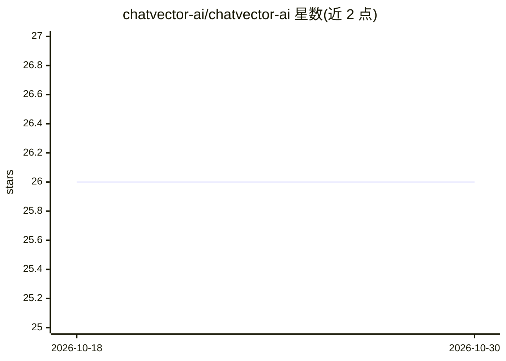

# chatvector-ai/chatvector-ai

⭐ 26 · Python · MIT · 推送 2026-10-29 · [GitHub](https://github.com/chatvector-ai/chatvector-ai) · 组织维护

**面向开发者的后端优先 RAG 引擎：文档摄取、索引与问答 API**

开源的文档智能 RAG 后端引擎，覆盖非结构化文档（PDF/文本/Markdown/HTML/DOCX）的摄取、语义分块、pgvector 向量存储、带引用的回答生成全流程，以 FastAPI 服务形式部署并通过 HTTP 集成。LLM 与嵌入提供商可插拔（Gemini/OpenAI/Ollama/Claude/Voyage），提供 Python/TypeScript SDK 与非核心的 Next.js 参考前端。混合检索、重排、GraphRAG 等功能默认关闭，多容器部署需 Redis 与 S3 制品。

## 筛选速览

| 维度 | 判定 | 备注 |
|---|---|---|
| AI 角色 | `ai-ecosystem` | LLM/agent 周边工具 |
| 许可风险 | `permissive` | MIT |
| 部署形态 | `self-host` | docker 或自建部署 |
| 模型依赖 | local-ok | 支持本地模型 |
| 硬件要求 | — | 无带数字的原话,不猜 |
| 安装摩擦 | `low` | 无编译、无系统依赖或容器化 |
| 成熟度 | — | 结构信号不足 |

## 能力要点

- 文档摄取全流程：分块、向量存储（pgvector）、带引用的 LLM 回答
- LLM/嵌入提供商可插拔：Gemini、OpenAI、Ollama、Claude、Voyage 可混搭
- 会话感知检索、可选混合检索/重排/查询变换/元数据过滤
- make quickstart 一条命令启动完整开发环境（Docker + Node.js）

## 适用场景

- 为内部知识系统或合同分析工具搭建文档问答后端
- 部署一个可经 HTTP 集成的文档问答 API 服务
- 试验不同的分块、检索与提示策略

## 场景标签

`RAG` `文档问答` · 领域:知识与检索

## 证据(README 行号)

> L40: The goal is to offer a **developer-focused RAG engine** you can deploy as a service and integrate via HTTP — not a 
> L29: ChatVector provides a **clean, extensible backend foundation for RAG-based document intelligence**. It handles the 

## 星数曲线

2026-10-18 26 → 2026-10-30 26（+0）

---
*卡片 v1 · prompt 1.4 · 生成 2026-10-26 · 置信度 mid · 依据 README sha `7e276ea3f429` · [字段定义](../../DATASET.md)*
