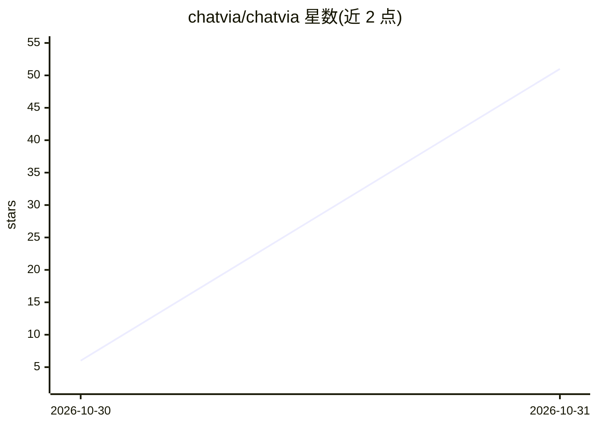

# chatvia/chatvia

⭐ 51 · PHP · NOASSERTION · 推送 2026-10-30 · [GitHub](https://github.com/chatvia/chatvia) · [官网](https://chatvia.ai) · 组织维护

**自托管 AI 聊天 agent 平台：基于自有知识库回答，多渠道部署**

基于 Laravel/PHP 与 PostgreSQL 的自托管 AI 聊天 agent 平台：团队创建 agent，导入文件、网页、文本、问答对、音视频作为知识源，通过 RAG 混合检索（pgvector 向量+关键词）在 PostgreSQL 内生成回答。每个 agent 可选不同模型（Claude/GPT/Gemini 或 Llama/Qwen 等开放权重模型）。支持接入 MCP 服务器与自定义工具，提供护栏、人工接管、多渠道（网站挂件、Slack、Teams、WhatsApp 等）与 REST API。通过一键脚本、Docker 或 Ubuntu 直装部署。

## 筛选速览

| 维度 | 判定 | 备注 |
|---|---|---|
| AI 角色 | `ai-native` | 本体是模型或模型工具 |
| 许可风险 | `none` | NOASSERTION |
| 部署形态 | `None` |  |
| 模型依赖 | locked-api |  |
| 硬件要求 | — | 无带数字的原话,不猜 |
| 安装摩擦 | `low` | 无编译、无系统依赖或容器化 |
| 成熟度 | — | 结构信号不足 |

## 能力要点

- RAG 混合检索（pgvector 向量+关键词）全部在 PostgreSQL 内完成
- 知识源支持文件、网页、文本、问答对、音频和视频
- 任意 MCP 服务器接入，高危工具调用可等待人工审批并全程记录
- 九种交付渠道：托管聊天页、网站挂件、命令栏、六个消息应用与 REST API

## 适用场景

- 我想在自有服务器上搭建基于公司文档的客服聊天机器人
- 我把同一个 agent 同时部署到网站挂件和 Slack/Teams 等消息渠道
- 我需要带护栏、人工接管与审计日志的面向客户的 AI 问答服务

## 场景标签

`聊天机器人` `文档问答` · 领域:对话与助手

## 证据(README 行号)

> L42: ChatVia.ai is a free, self-hosted platform for AI chat agents that answer from
> L50: retrieval-augmented generation (RAG) with hybrid search (vectors and keywords)

## 星数曲线

2026-10-30 6 → 2026-10-31 51（+45）

---
*卡片 v1 · prompt 1.4 · 生成 2026-10-30 · 置信度 high · 依据 README sha `d12e8ee332dd` · [字段定义](../../DATASET.md)*
