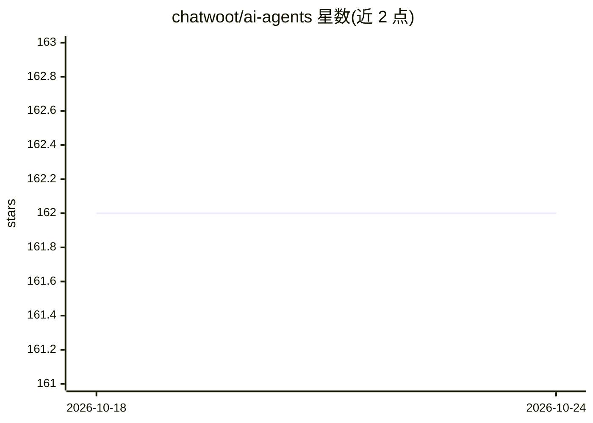

# chatwoot/ai-agents

⭐ 163 · Ruby · MIT · 推送 2026-10-15 · [GitHub](https://github.com/chatwoot/ai-agents) · [官网](https://ai-agents.chatwoot.dev/) · 组织维护

**面向 Ruby 开发者的多 agent 工作流构建 SDK**

Provider 无关的 Ruby AI Agents SDK，用于构建多 agent 工作流：提供 agent 间透明 handoff、自定义工具调用、JSON schema 校验的结构化输出与跨 agent 的共享上下文状态管理。核心组件包括不可变且线程安全的 Agent、可复用的 AgentRunner、可序列化的 Context、Tools 与 Handoffs。支持 OpenAI、Anthropic 等 LLM 提供商及 Azure 自定义部署，提供可选的 OpenTelemetry 观测（兼容 Langfuse 等 OTel 后端）。基于 RubyLLM 实现 LLM 集成，设计参考 OpenAI Agents SDK。通过 Gemfile 安装，附 examples 目录示例。

## 筛选速览

| 维度 | 判定 | 备注 |
|---|---|---|
| AI 角色 | `ai-ecosystem` | LLM/agent 周边工具 |
| 许可风险 | `permissive` | MIT |
| 部署形态 | `None` |  |
| 模型依赖 | — | README 未给出锁定关系 |
| 硬件要求 | — | 无带数字的原话,不猜 |
| 安装摩擦 | `low` | 无编译、无系统依赖或容器化 |
| 成熟度 | — | 结构信号不足 |

## 能力要点

- 多 agent 编排与透明 handoff（hub-and-spoke 等模式）
- 线程安全的 Agent 与可序列化的共享上下文
- 结构化输出：JSON schema 校验的响应
- 可选 OpenTelemetry 观测，兼容 Langfuse 等 OTel 后端

## 适用场景

- 在 Ruby 应用中构建客服分流等多 agent 工作流
- 让 agent 调用自定义工具对接外部 API/数据库
- 通过共享上下文和可序列化状态管理跨会话对话

## 场景标签

`多智能体` `Agent 框架` · 领域:Agent 开发

## 证据(README 行号)

> L3: A delightful provider agnostic Ruby SDK for building multi-agent AI workflows with seamless handoffs tool calling, a
> L7: - **🤖 Multi-Agent Orchestration**: Create specialized AI agents that work together

## 星数曲线

2026-10-18 162 → 2026-10-24 162（+0）

---
*卡片 v1 · prompt 1.4 · 生成 2026-10-22 · 置信度 high · 依据 README sha `3aba16ed7956` · [字段定义](../../DATASET.md)*
