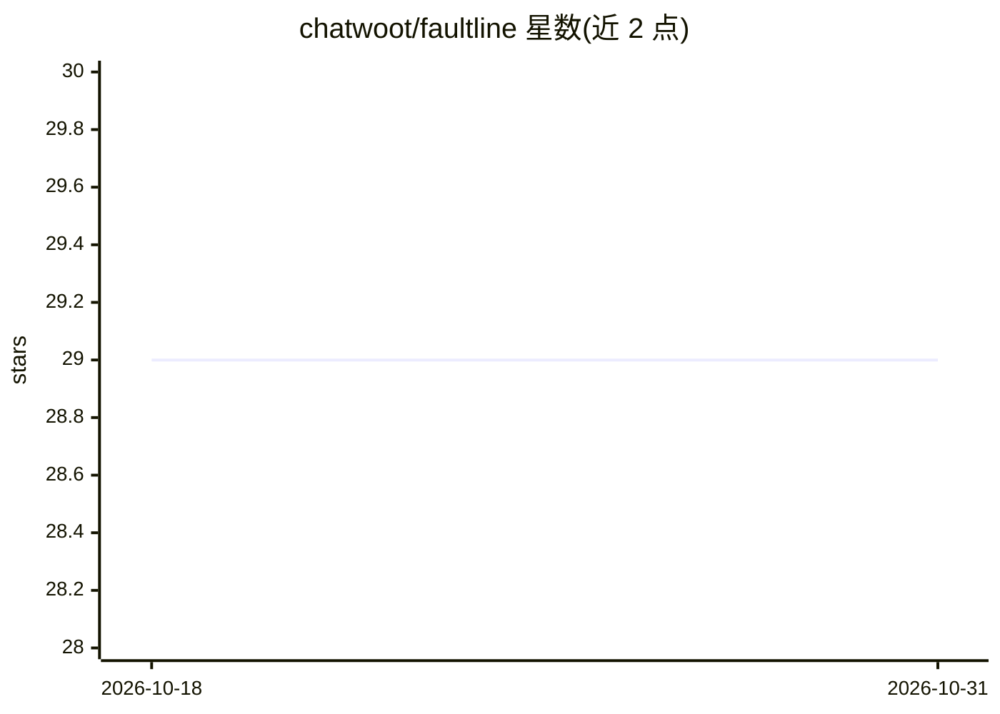

# chatwoot/faultline

⭐ 29 · Python · MIT · 推送 2026-03-12 · [GitHub](https://github.com/chatwoot/faultline) · [官网](https://faultline.chatwoot.com) · 组织维护

**基础设施调试 AI agent：自然语言查监控工具并给出根因分析**

Chatwoot 开源的基础设施排障 AI agent 应用：用户用自然语言提问，agent 通过 MCP 服务器与自定义工具查询 New Relic、Sentry、AWS、GitHub、PagerDuty 等集成，自主迭代工具调用并返回完整根因分析。技术栈为 Vue 3 + Rails 8 + Python/FastAPI agent（OpenAI SDK）+ PostgreSQL/Redis，以 Docker Compose 5 容器部署，OpenAI API key 为必填环境变量。支持多租户工作区、流式响应与基础设施拓扑图。

## 筛选速览

| 维度 | 判定 | 备注 |
|---|---|---|
| AI 角色 | `ai-native` | 本体是模型或模型工具 |
| 许可风险 | `permissive` | MIT |
| 部署形态 | `self-host` | docker 或自建部署 |
| 模型依赖 | — | README 未给出锁定关系 |
| 硬件要求 | — | 无带数字的原话,不猜 |
| 安装摩擦 | `low` | 无编译、无系统依赖或容器化 |
| 成熟度 | — | 结构信号不足 |

## 能力要点

- 自主 agent 循环：迭代工具调用逐层下钻分析
- MCP + 原生集成覆盖 New Relic/Sentry/AWS/GitHub/PagerDuty，凭据静态加密
- OpenAI 模型可选，流式展示文本与工具调用（SSE + ActionCable）
- 多租户工作区与角色权限（Pundit）、Vue Flow 基础设施拓扑图

## 适用场景

- 故障排查时用自然语言查询各监控平台数据定位根因
- 团队共享持久化的排障会话与基础设施拓扑
- 自托管部署在内网，统一接入多云账号与告警系统

## 场景标签

`AI 助手` · 领域:对话与助手

## 证据(README 行号)

> L5: An open-source AI agent for infrastructure debugging. Ask questions about your infrastructure in plain English — it 
> L16: You ask a question. The agent uses MCP (Model Context Protocol) servers and custom tools to query your integrations
> L141: - **Autonomous agent loop** — iterates through tool calls, drilling deeper each round

## 星数曲线

2026-10-18 29 → 2026-10-31 29（+0）

---
*卡片 v1 · prompt 1.4 · 生成 2026-10-26 · 置信度 high · 依据 README sha `3f1aaedb5caa` · [字段定义](../../DATASET.md)*
