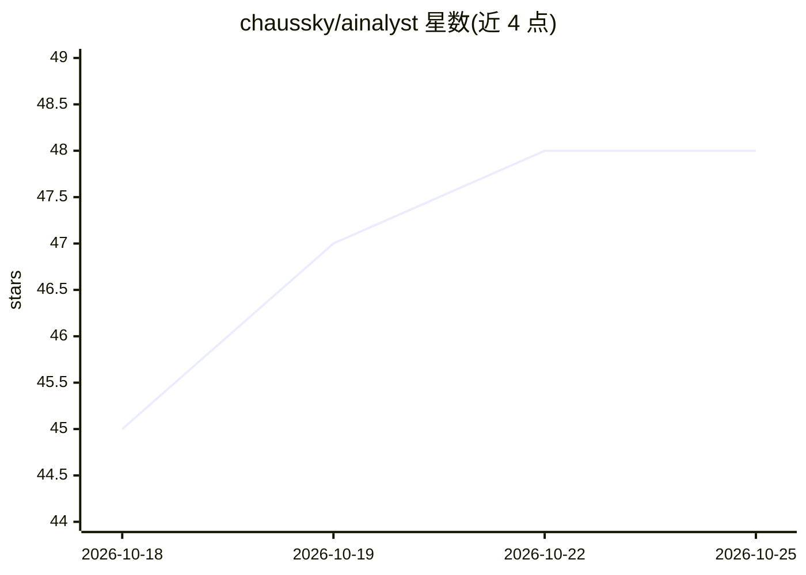

# chaussky/ainalyst

⭐ 48 · Python · AGPL-3.0 · 推送 2026-08-31 · [GitHub](https://github.com/chaussky/ainalyst) · 个人维护 · 中文 README

**基于 Claude Code 的 BABOK v3 业务分析 AI 助手平台**

面向业务分析师（及临时承担该角色的产品/项目经理）的 AI 助手：底层为 Anthropic Claude 模型，通过 Claude Code agent 执行，上层由 21 个技能与 22 个 MCP 服务器（114 个工具）覆盖 BABOK 第 3-7 章任务。技能含 YAML 触发器，按语义匹配激活；大型任务可拆分为四个 agent。支持访谈、干系人地图、需求追溯、需求质量校验（9 项 BABOK 特征）与多种优先级方法。安装需 Python 3.10+、Git、VS Code 与 Anthropic Pro 及以上订阅，处于 Public Beta。

## 筛选速览

| 维度 | 判定 | 备注 |
|---|---|---|
| AI 角色 | `ai-native` | 本体是模型或模型工具 |
| 许可风险 | `dual` | AGPL-3.0 |
| 部署形态 | `desktop` | 安装包/桌面程序 |
| 模型依赖 | locked-api |  |
| 硬件要求 | — | 无带数字的原话,不猜 |
| 安装摩擦 | `low` | 无编译、无系统依赖或容器化 |
| 成熟度 | — | 结构信号不足 |

## 能力要点

- 21 个技能 + 22 个 MCP 服务器（114 个工具）覆盖 BABOK 第 3-7 章
- 技能带语义触发器，按用户请求自动匹配激活
- 大型任务可拆分为对话、拆解、推理、写盘四个 agent
- 按 9 项 BABOK 特征校验需求质量并给出改写建议

## 适用场景

- 变更请求的影响分析：追溯图遍历找出受影响制品
- 为不同项目情境选择 MoSCoW/WSJF 等优先级方法
- 交接开发前批量校验需求表述质量
- 无专职 BA 的团队按 BABOK 方法论开展需求工作

## 场景标签

`AI 助手` · 领域:对话与助手

## 证据(README 行号)

> L11: **AInalyst** is an AI assistant that works alongside you like a seasoned analyst colleague. It knows the BABOK v3 m
> L17: At the core of the platform is Anthropic's Claude large language model. One level up is Claude Code, an AI agent th

## 星数曲线

2026-10-18 45 → 2026-10-25 48（+3）

---
*卡片 v1 · prompt 1.4 · 生成 2026-10-25 · 置信度 mid · 依据 README sha `98fdd9e938cd` · [字段定义](../../DATASET.md)*
