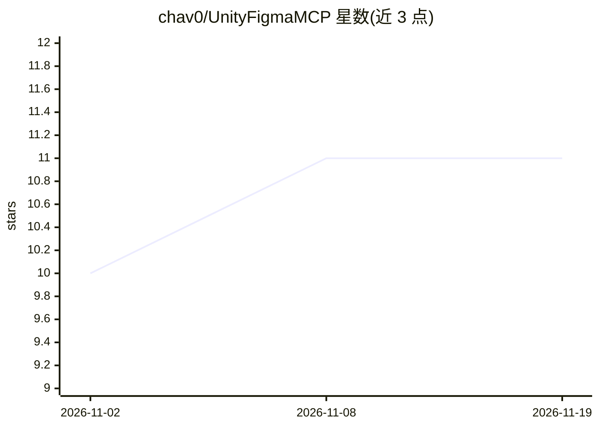

# chav0/UnityFigmaMCP

⭐ 11 · C# · MIT · 推送 2026-10-12 · [GitHub](https://github.com/chav0/UnityFigmaMCP) · 个人维护

**让 AI agent 从 Figma 设计生成 Unity UI prefab 的 MCP 服务器**

由 MCP 服务器（.NET 8）与 Unity Editor 包两部分组成，通过 SignalR 在本机实时连接 Unity Editor。AI agent 读取 Figma 设计树后调用 13 个 MCP 工具，在 Unity 中运行布局管线（RectTransform、TextMeshPro、Image、Layout Groups、Grid、ContentSizeFitter）生成 .prefab，并支持编辑、保存、子 prefab 提取、sprite 导入与资产绑定。另附 6 个 Markdown 格式 AI 技能工作流，兼容任何支持 MCP 的 agent。全流程本地运行，需自备 Figma token、Unity 2021.3+ 与 .NET 8 SDK。

## 筛选速览

| 维度 | 判定 | 备注 |
|---|---|---|
| AI 角色 | `ai-ecosystem` | LLM/agent 周边工具 |
| 许可风险 | `permissive` | MIT |
| 部署形态 | `None` |  |
| 模型依赖 | — | README 未给出锁定关系 |
| 硬件要求 | — | 无带数字的原话,不猜 |
| 安装摩擦 | `medium` | 含编译或系统依赖之一 |
| 成熟度 | — | 结构信号不足 |

## 能力要点

- 13 个 MCP 工具覆盖 Figma 数据获取到 prefab 构建/编辑/资产绑定
- 6 个 Markdown 技能工作流，兼容任意 MCP agent
- 可配置布局管线，支持复用已绑定的 sprite 与 prefab
- 本地运行，Figma token 不离开本机

## 适用场景

- 把 Figma 设计稿直接转成 Unity UI prefab 而不手写代码
- Figma 设计更新后同步已有 prefab
- 把现有 Unity UI kit 的 sprite 与 prefab 绑定到 Figma 组件

## 场景标签

`代码生成` · 领域:编码与开发

## 证据(README 行号)

> L9: Build Unity UI prefabs from Figma designs using AI agents via Model Context Protocol.
> L34: **13 MCP tools** for full Figma-to-Unity control:

## 星数曲线

2026-11-02 10 → 2026-11-19 11（+1）

---
*卡片 v1 · prompt 1.4 · 生成 2026-11-18 · 置信度 high · 依据 README sha `7fa4bb3d795f` · [字段定义](../../DATASET.md)*
