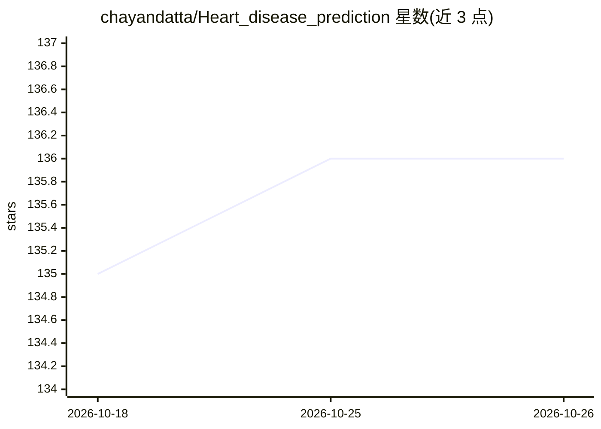

# chayandatta/Heart_disease_prediction

⭐ 136 · Jupyter Notebook · MIT · 推送 2026-08-15 · [GitHub](https://github.com/chayandatta/Heart_disease_prediction) · 个人维护

**比较五种分类算法预测心脏病的机器学习教学项目**

基于 Cleveland 心脏病数据集（14 个临床属性）的 Jupyter Notebook 项目：训练并比较 Logistic Regression、Random Forest、Naive Bayes、KNN、Decision Tree 五种监督分类算法，流程覆盖数据探索、预处理、训练、评估与超参数实验，并附项目报告与演示文稿。以 git clone 获取仓库、pip 安装依赖后运行 notebook。README 明确声明仅限教育与研究用途，非医疗诊断系统，数据集较小且不适用于临床部署。面向机器学习入门学习者。

## 筛选速览

| 维度 | 判定 | 备注 |
|---|---|---|
| AI 角色 | `ai-native` | 本体是模型或模型工具 |
| 许可风险 | `permissive` | MIT |
| 部署形态 | `library` | 以包/库形式分发 |
| 模型依赖 | — | README 未给出锁定关系 |
| 硬件要求 | — | 无带数字的原话,不猜 |
| 安装摩擦 | `low` | 无编译、无系统依赖或容器化 |
| 成熟度 | — | 结构信号不足 |

## 能力要点

- 五种分类算法在同一数据集上的训练与对比
- 基于 Cleveland 数据库的心脏病数据集（14 属性）
- 包含数据探索、预处理、评估与超参数实验的完整流程
- 附项目报告 PDF 与演示 PPT

## 适用场景

- 学习监督学习与二分类的完整工作流
- 对比不同分类算法在同一数据集上的表现
- 作为机器学习课程或入门练习项目

## 场景标签

`教程课程` · 领域:学习与行业

## 证据(README 行号)

> L14: > A machine learning project that compares five classification algorithms for predicting the presence of heart dise
> L22: The project compares **five different machine learning algorithms**:

## 星数曲线

2026-10-18 135 → 2026-10-26 136（+1）

---
*卡片 v1 · prompt 1.4 · 生成 2026-10-22 · 置信度 mid · 依据 README sha `3d857579a819` · [字段定义](../../DATASET.md)*
