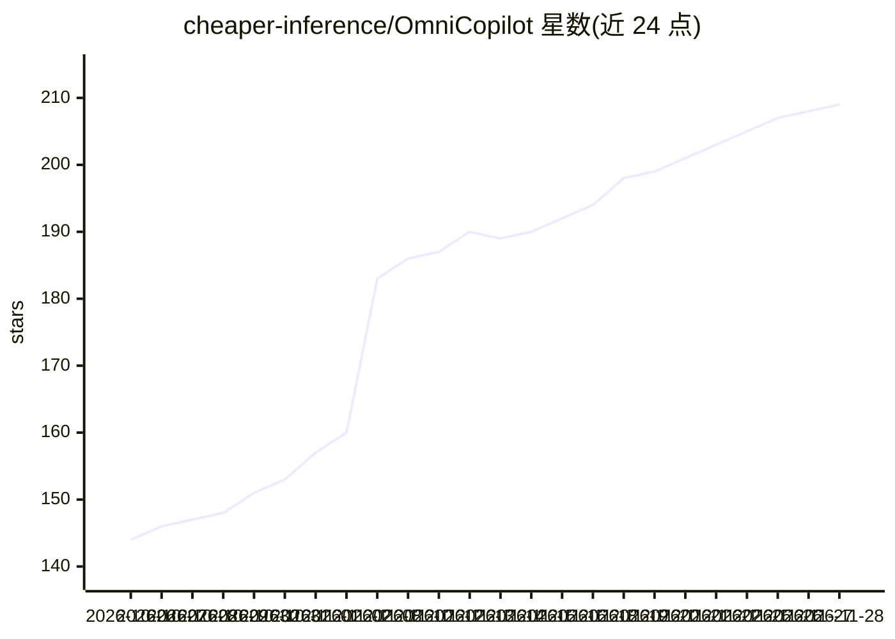

# cheaper-inference/OmniCopilot

⭐ 209 · TypeScript · MIT · 推送 2026-11-27 · [GitHub](https://github.com/cheaper-inference/OmniCopilot) · [官网](https://github.com/diegosouzapw/OmniRoute) · 个人维护

**把 OmniRoute 的 1200+ 模型接入 VS Code Copilot Chat 的扩展**

VS Code 扩展，通过 VS Code 原生语言模型 provider API，把 OmniRoute 服务器提供的 340+ provider、1200+ 模型注入 Copilot Chat 的模型选择器。支持 agent mode、工具调用、MCP、视觉附件、推理过程流式展示与组合自动回退。API key 存于系统钥匙串，UI 支持 42 种语言。需先运行 OmniRoute 服务器（npm 全局安装），VS Code 1.122 起无需 Copilot 订阅即可使用。

## 筛选速览

| 维度 | 判定 | 备注 |
|---|---|---|
| AI 角色 | `ai-ecosystem` | LLM/agent 周边工具 |
| 许可风险 | `permissive` | MIT |
| 部署形态 | `library` | 以包/库形式分发 |
| 模型依赖 | local-ok | 支持本地模型 |
| 硬件要求 | — | 无带数字的原话,不猜 |
| 安装摩擦 | `low` | 无编译、无系统依赖或容器化 |
| 成熟度 | — | 结构信号不足 |

## 能力要点

- 接入 VS Code 原生语言模型 API，模型直接出现在 Copilot Chat 选择器
- 支持 agent mode、tool calling、MCP、视觉附件与推理流式输出
- OmniRoute combos 提供跨 provider 自动 failover
- 一条命令为 Codex CLI、Claude Code、Cline 等工具生成 OmniRoute 配置

## 适用场景

- 无 Copilot 订阅时在 VS Code 中使用自有模型做 AI 对话
- 在 Copilot Chat 中按价格与上下文窗口挑选 1200+ 模型
- 团队按 workspace 管理 OmniRoute API key 并按项目分组用量

## 场景标签

`模型网关` `AI 助手` · 领域:Agent 开发

## 证据(README 行号)

> L17: **Don't replace Copilot — power it up.** No new sidebar to learn, no new chat UI. This extension drops every model 
> L24: - **Agent mode, tool calling, MCP, instructions — all of it still works.** This plugs into VS Code's native languag

## 星数曲线

2026-10-26 144 → 2026-11-28 209（+65）

---
*卡片 v1 · prompt 1.4 · 生成 2026-11-26 · 置信度 high · 依据 README sha `7d9ee59c8142` · [字段定义](../../DATASET.md)*
