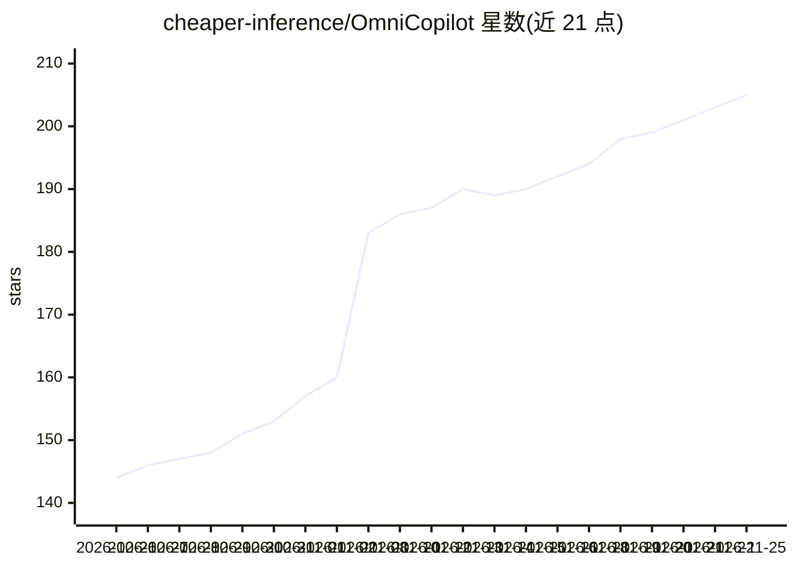

# cheaper-inference/OmniCopilot

⭐ 205 · TypeScript · MIT · 推送 2026-11-23 · [GitHub](https://github.com/cheaper-inference/OmniCopilot) · [官网](https://github.com/diegosouzapw/OmniRoute) · 组织维护

**把 1200+ 模型接入 GitHub Copilot Chat 的 VS Code 扩展**

由 Cheaper Inference 提供的 VS Code 扩展，将 OmniRoute 聚合端点（340+ 提供商、1200+ 模型）注入 Copilot Chat 原生模型选择器，需自建或连接 OmniRoute 服务器。保留 Copilot 的 agent 模式、工具调用、MCP 与视觉能力，支持组合模型自动故障转移、思考链展示、按模型配置推理档位，并可一键为 Codex CLI、Claude Code、Cursor 等工具生成配置。API key 存于 OS 钥匙串并绑定服务器。

## 筛选速览

| 维度 | 判定 | 备注 |
|---|---|---|
| AI 角色 | `ai-ecosystem` | LLM/agent 周边工具 |
| 许可风险 | `permissive` | MIT |
| 部署形态 | `library` | 以包/库形式分发 |
| 模型依赖 | local-ok | 支持本地模型 |
| 硬件要求 | — | 无带数字的原话,不猜 |
| 安装摩擦 | `low` | 无编译、无系统依赖或容器化 |
| 成熟度 | `idea` | |

## 能力要点

- 340+ 提供商、1200+ 模型经单一 OmniRoute 端点接入 Copilot Chat 模型选择器
- 组合模型（优先/轮询/成本优化）自动故障转移
- 一条命令为 Codex CLI、Claude Code、Cline、Cursor 等生成配置
- API key 存于 VS Code SecretStorage，绑定服务器且忽略工作区级 URL 覆盖

## 适用场景

- 不换聊天界面，在 Copilot Chat 里选用自有/免费模型
- 为团队项目按工作区分配独立 API key 并跟踪用量
- 在模型间设置自动故障转移与成本上限

## 场景标签

`模型网关` · 领域:Agent 开发

## 证据(README 行号)

> L17: **Don't replace Copilot — power it up.** No new sidebar to learn, no new chat UI. This extension drops every model 
> L23: - **1200+ models, one picker.** OmniRoute unifies 340+ providers (OpenAI-compatible, Anthropic, Gemini, Ollama, loc

## 星数曲线

2026-10-26 144 → 2026-11-25 205（+61）

---
*卡片 v1 · prompt 1.4 · 生成 2026-11-17 · 置信度 mid · 依据 README sha `957ba432b9ea` · [字段定义](../../DATASET.md)*
