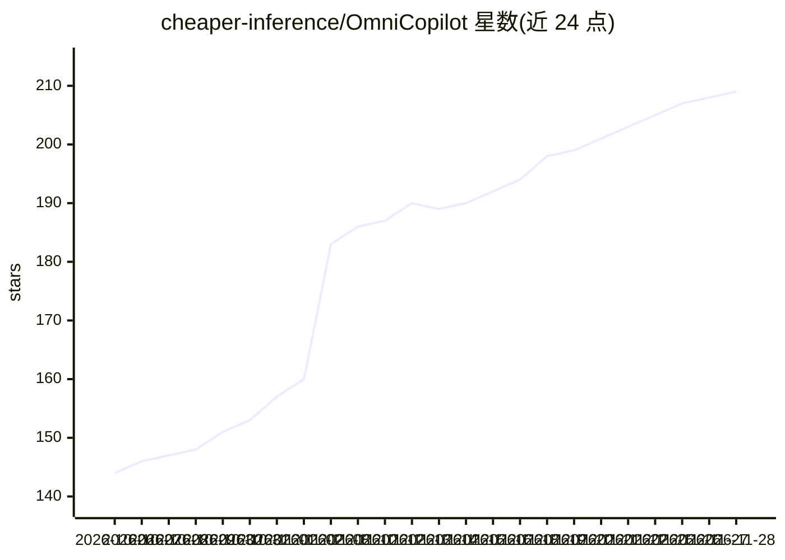

# cheaper-inference/OmniCopilot

⭐ 209 · TypeScript · MIT · 推送 2026-11-27 · [GitHub](https://github.com/cheaper-inference/OmniCopilot) · [官网](https://github.com/diegosouzapw/OmniRoute) · 个人维护

**把数百个 AI 模型接入现有 Copilot Chat 模型选择器的 VS Code 扩展**

VS Code 扩展，通过 VS Code 原生语言模型 provider API，把 OmniRoute 路由服务器聚合的数百个模型（OpenAI-compatible、Anthropic、Gemini、Ollama、本地等）注入用户已有的 Copilot Chat 模型下拉框，无需 Copilot 订阅。保留 agent mode、工具调用、MCP、视觉附件与推理流式输出；支持组合模型与自动 failover、状态栏连接指示、42 种语言 UI、API key 存入 OS keychain。需先以 npm 全局安装并运行 omniroute 服务器（默认 localhost:20128）。

## 筛选速览

| 维度 | 判定 | 备注 |
|---|---|---|
| AI 角色 | `ai-ecosystem` | LLM/agent 周边工具 |
| 许可风险 | `permissive` | MIT |
| 部署形态 | `library` | 以包/库形式分发 |
| 模型依赖 | local-ok | 支持本地模型 |
| 硬件要求 | — | 无带数字的原话,不猜 |
| 安装摩擦 | `low` | 无编译、无系统依赖或容器化 |
| 成熟度 | — | 结构信号不足 |

## 能力要点

- 接入 VS Code 原生语言模型 API，Copilot Chat 原有功能（agent mode、工具调用、MCP）保持可用
- 组合模型（priority、round-robin、cost-optimized、fusion）作为普通模型出现并自动跨提供商 failover
- API key 存于 OS keychain，workspace 值被忽略以防仓库劫持服务器地址
- 一条命令为 Codex CLI、Claude Code、Cline、Continue、Cursor、Aider 等生成 OmniRoute 配置

## 适用场景

- 无 Copilot 订阅时在 VS Code 中获得带 agent mode 的 AI 聊天
- 在 Copilot Chat 中自由切换 OmniRoute 聚合的模型与组合
- 为团队多个项目分别配置工作区级 API key

## 场景标签

`模型网关` · 领域:Agent 开发

## 证据(README 行号)

> L17: **Don't replace Copilot — power it up.** No new sidebar to learn, no new chat UI. This extension drops every model 
> L23: - **Every model, one picker.** OmniRoute unifies hundreds of providers (OpenAI-compatible, Anthropic, Gemini, Ollam
> L24: - **Agent mode, tool calling, MCP, instructions — all of it still works.** This plugs into VS Code's native languag

## 星数曲线

2026-10-26 144 → 2026-11-28 209（+65）

---
*卡片 v1 · prompt 1.4 · 生成 2026-11-28 · 置信度 high · 依据 README sha `ce6a12ad7a7d` · [字段定义](../../DATASET.md)*
