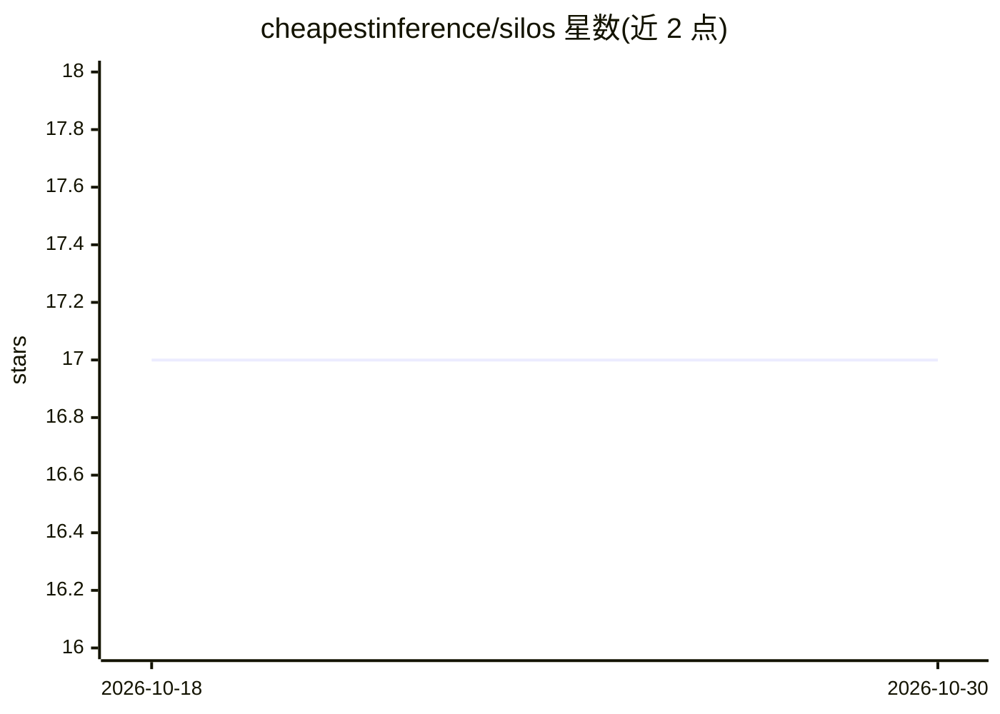

# cheapestinference/silos

⭐ 17 · TypeScript · MIT · 推送 2026-04-19 · [GitHub](https://github.com/cheapestinference/silos) · [官网](https://silosplatform.com) · 组织维护

**OpenClaw AI agent 的自托管 Web 管理面板**

面向 OpenClaw 生态的开源 Web 仪表盘：通过浏览器实时监控与配置 AI agent，提供 Brain 文件编辑（SOUL/IDENTITY/MEMORY/BOOTSTRAP）、工作区文件 CRUD、按 agent 切换 GPT/Claude/DeepSeek/Mistral 模型、Kanban 任务管道、Cron 调度、WhatsApp/Telegram/Discord/Slack 渠道一键配对、ClawHub 技能市场与 Gateway 连接管理。基于 React 19/TypeScript/Firebase Auth，支持 Docker 自托管，另提供 SilosPlatform.com 托管服务。

## 筛选速览

| 维度 | 判定 | 备注 |
|---|---|---|
| AI 角色 | `ai-ecosystem` | LLM/agent 周边工具 |
| 许可风险 | `permissive` | MIT |
| 部署形态 | `self-host` | docker 或自建部署 |
| 模型依赖 | — | README 未给出锁定关系 |
| 硬件要求 | — | 无带数字的原话,不猜 |
| 安装摩擦 | `low` | 无编译、无系统依赖或容器化 |
| 成熟度 | — | 结构信号不足 |

## 能力要点

- 实时编辑 agent 的 SOUL/IDENTITY/MEMORY 等 Brain 文件
- Kanban 任务管道与 Cron 表达式调度
- WhatsApp/Telegram/Discord/Slack 多渠道一键配对
- 从 ClawHub 浏览、安装与管理技能

## 适用场景

- 不想用终端和配置文件，改用 Web 界面管理我的 agent
- 实时查看 agent 的 token 用量与任务执行状态
- 给多个 agent 分别配置不同模型与工具权限

## 场景标签

 · 领域:AI agent 运维/管理面板

## 证据(README 行号)

> L1: # 🚀 Silos: The Command Center for OpenClaw
> L43: Silos isn't just a UI; it's a complete management layer for the OpenClaw ecosystem.

## 星数曲线

2026-10-18 17 → 2026-10-30 17（+0）

---
*卡片 v1 · prompt 1.4 · 生成 2026-10-29 · 置信度 high · 依据 README sha `992077a54ecf` · [字段定义](../../DATASET.md)*
