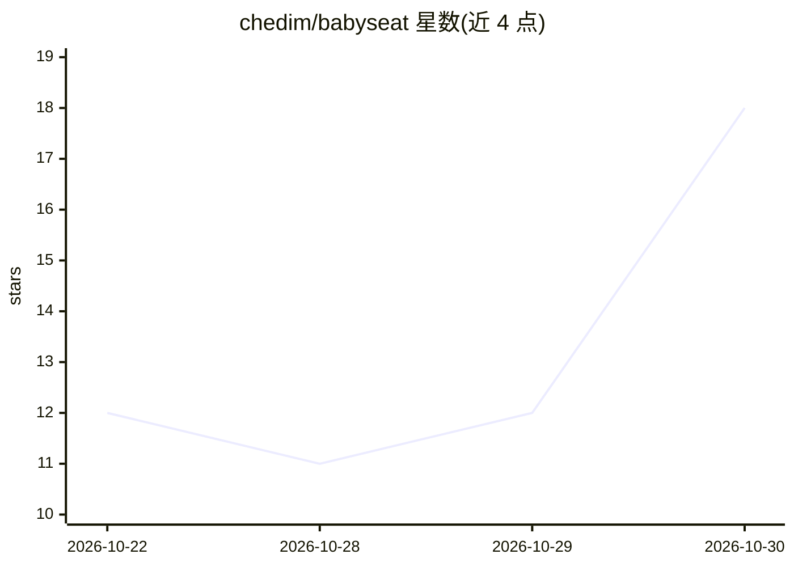

# chedim/babyseat

⭐ 18 · Python · MIT · 推送 2026-10-29 · [GitHub](https://github.com/chedim/babyseat) · 个人维护

**本地运行的带实时记忆的 LLM 代理座椅，替代全量聊天历史**

babyseat 是一个本地优先的 AI 运行时：作为 OpenAI 兼容代理坐在模型（Ollama、OpenAI 兼容云 API、经 Claude Code 引擎的 Claude）之前，把流经的每条消息实时解析为实体记忆，并在后续对话中只注入相关记忆与变化而非完整历史。学习仅需嵌入模型，无 LLM 总结步骤；提供自带网页 UI、语音、MCP 工具面，可独立运行、Docker 部署或作为 Home Assistant 集成。需要 Ollama 服务器（聊天与嵌入模型）及 1–3 GB 内存，README 标注为 beta。

## 筛选速览

| 维度 | 判定 | 备注 |
|---|---|---|
| AI 角色 | `ai-ecosystem` | LLM/agent 周边工具 |
| 许可风险 | `permissive` | MIT |
| 部署形态 | `self-host` | docker 或自建部署 |
| 模型依赖 | local-ok | 支持本地模型 |
| 硬件要求 | — | 无带数字的原话,不猜 |
| 安装摩擦 | `low` | 无编译、无系统依赖或容器化 |
| 成熟度 | — | 结构信号不足 |

## 能力要点

- 实时代理：解析流经的对话为实体记忆，学习仅需嵌入模型
- 每轮注入约 900 字符的对话状态块与 12 条 RECALL 记录，替代全量历史
- 多客户端接入：OpenAI 兼容 API、Ollama 客户端、MCP（含 Claude Code）、opencode
- 本地优先：无账号无遥测，可 Docker 部署或嵌入 Home Assistant

## 适用场景

- 让本地或云端模型获得跨会话记忆而不膨胀上下文
- 在 Home Assistant 中运行带记忆的对话 agent
- 通过 OpenAI/Ollama 兼容接口给现有客户端加记忆层

## 场景标签

`Agent 记忆` · 领域:Agent 开发

## 证据(README 行号)

> L6: babyseat is an AI seat with a memory that learns in real time. Everything you
> L34: ### 1. A real-time proxy that learns from whatever passes through it
> L104: babyseat runs three ways: standalone, in Docker, or inside Home Assistant. All

## 星数曲线

2026-10-22 12 → 2026-10-30 18（+6）

---
*卡片 v1 · prompt 1.4 · 生成 2026-10-30 · 置信度 high · 依据 README sha `f3d3edc5fbb0` · [字段定义](../../DATASET.md)*
