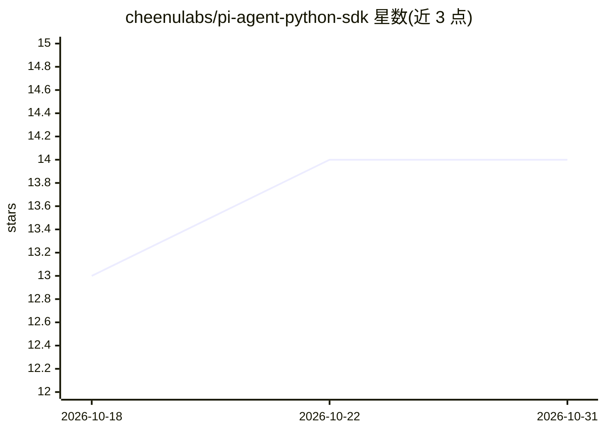

# cheenulabs/pi-agent-python-sdk

⭐ 14 · Python · MIT · 推送 2026-10-27 · [GitHub](https://github.com/cheenulabs/pi-agent-python-sdk) · [官网](https://pypi.org/project/pi-agent-python-sdk/) · 组织维护

**把终端编码 agent Pi 封装为 Python API 的社区 SDK**

面向已安装 Pi CLI 的开发者的非官方社区 SDK：通过 Pi 的 JSONL RPC 协议（stdin/stdout 子进程），提供带类型的同步与异步 Python 客户端，支持运行提示、流式接收文本/thinking/工具事件、会话续接/fork/clone、切换模型与 thinking 等级、中途引导与上下文压缩。复用 Pi CLI 已有配置、工具与扩展，可加载自定义扩展。要求 Python 3.11+、Node.js 22.19.0+、Pi 0.85.1+（测试基线 1.4.0），并需自配模型提供商。

## 筛选速览

| 维度 | 判定 | 备注 |
|---|---|---|
| AI 角色 | `ai-ecosystem` | LLM/agent 周边工具 |
| 许可风险 | `permissive` | MIT |
| 部署形态 | `library` | 以包/库形式分发 |
| 模型依赖 | — | README 未给出锁定关系 |
| 硬件要求 | — | 无带数字的原话,不猜 |
| 安装摩擦 | `low` | 无编译、无系统依赖或容器化 |
| 成熟度 | — | 结构信号不足 |

## 能力要点

- 同步/异步双客户端，覆盖 run/stream/prompt 及命令方法
- 会话管理：续接、恢复、fork、clone、不落盘模式
- 通过 Pi 的 JSONL RPC 协议与子进程通信，复用 CLI 配置与扩展
- 支持运行中切换模型、设置 thinking 等级与中途引导

## 适用场景

- 在 Python 应用中调用 Pi 编码 agent 完成代码问答与任务
- 把 Pi 会话接入自动化流水线并流式处理事件
- 复用已配置的 Pi 环境，从 Python 控制模型与会话

## 场景标签

`编码 Agent` · 领域:编码与开发

## 证据(README 行号)

> L14: terminal. This unofficial community SDK puts *your* Pi behind a typed sync and
> L199: The SDK speaks Pi's existing JSONL protocol over stdin/stdout:
> L204:         pi --mode rpc

## 星数曲线

2026-10-18 13 → 2026-10-31 14（+1）

---
*卡片 v1 · prompt 1.4 · 生成 2026-10-31 · 置信度 mid · 依据 README sha `47b6fef43524` · [字段定义](../../DATASET.md)*
