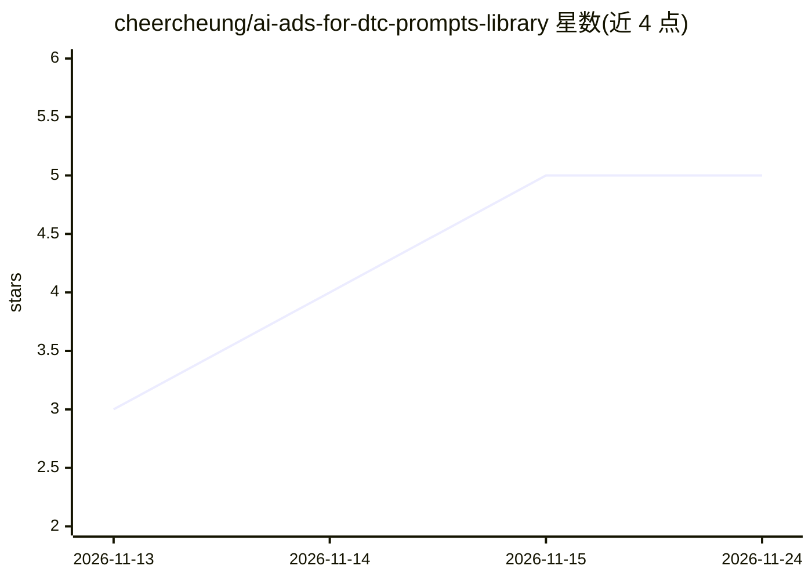

# cheercheung/ai-ads-for-dtc-prompts-library

⭐ 5 · Python · NOASSERTION · 推送 2026-11-05 · [GitHub](https://github.com/cheercheung/ai-ads-for-dtc-prompts-library) · [官网](evolink.ai/prompts/ugc-ads) · 个人维护

**面向 DTC 品牌的 109 条 AI 广告提示词库，11 种语言导航**

面向直销消费品（DTC）品牌的提示词集合：109 条完整提示词按 UGC 广告（20 条）、四类 Hooks（70 条）、CTA（19 条）组织，覆盖美妆、食品饮料、服饰、家居、宠物、消费电子等实体产品类目。每条 Hook 与 CTA 条目为完整创意简报，可请求图片、视频概念、脚本或文案变体等多种交付物。提示词以 [PRODUCT]、[BRAND] 等占位字段填空使用，附 20 个 UGC 示例视频与 11 种语言的导航。使用方式为复制提示词后在文本/图像/视频工作流中运行。

## 筛选速览

| 维度 | 判定 | 备注 |
|---|---|---|
| AI 角色 | `ai-knowledge` | 知识聚合/清单类 |
| 许可风险 | `none` | NOASSERTION |
| 部署形态 | `None` |  |
| 模型依赖 | — | README 未给出锁定关系 |
| 硬件要求 | — | 无带数字的原话,不猜 |
| 安装摩擦 | `low` | 无编译、无系统依赖或容器化 |
| 成熟度 | — | 结构信号不足 |

## 能力要点

- 109 条完整提示词，按 UGC Ads / Hooks / CTA 三类组织
- 四类 Hooks：好奇、痛点、利益与优惠、故事型
- 占位字段填空式模板（[PRODUCT]、[USP]、[OFFER] 等）
- 11 种语言导航与 20 个 UGC 示例视频

## 适用场景

- 为实体消费品生成 UGC 风格广告的创意概念
- 为短视频广告挑选开头 hook 与结尾 CTA
- 为电商广告产出脚本、图片或文案变体的提示词参考

## 场景标签

`提示工程` `AI 写作` · 领域:Agent 开发

## 证据(README 行号)

> L22: A prompt library for creating ads for physical products sold directly to consumers. Find a UGC concept, an opening 
> L5: 109 prompt templates · UGC Ads · Hooks · CTA
> L30: 1. Choose a category and open a prompt.

## 星数曲线

2026-11-13 3 → 2026-11-24 5（+2）

---
*卡片 v1 · prompt 1.4 · 生成 2026-11-21 · 置信度 high · 依据 README sha `19f8994a5da8` · [字段定义](../../DATASET.md)*
