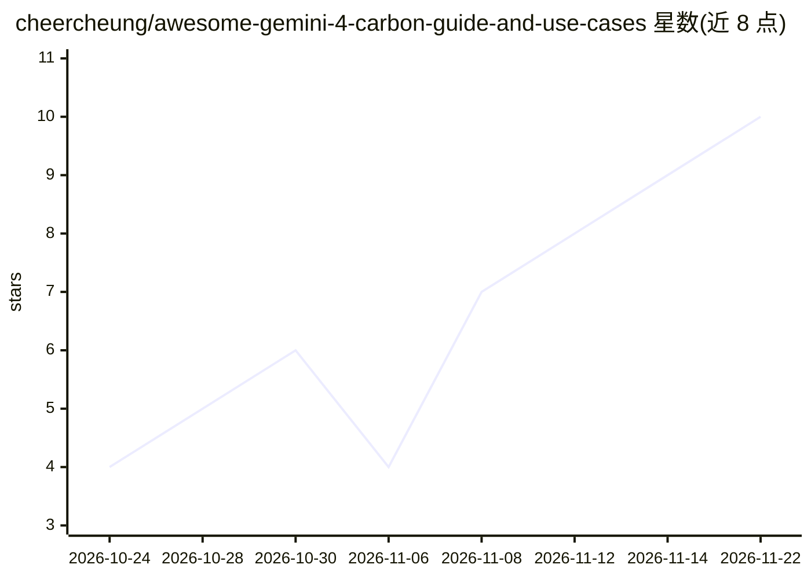

# cheercheung/awesome-gemini-4-carbon-guide-and-use-cases

⭐ 10 · Python · CC-BY-4.0 · 推送 2026-11-19 · [GitHub](https://github.com/cheercheung/awesome-gemini-4-carbon-guide-and-use-cases) · 个人维护

**Gemini 4 Carbon 社区用例编目：44 例演示与局限索引**

收录公开发布者归于 Gemini 4 Carbon 早期发布期的社区演示案例，共 44 个用例、5 个类别（机械与 3D 物体、体素世界、SVG 交互图形、游戏动画、模型对比），每条含任务描述、来源视频链接、来源自报的时间与限制说明。README 明确声明模型名称、生成时长与质量判断均为来源自报，不独立验证代码可运行性或可复现性；转发与底层作品归组，避免重复计数。以 CC BY 4.0 发布，提供 12 种语言的界面文本。

## 筛选速览

| 维度 | 判定 | 备注 |
|---|---|---|
| AI 角色 | `ai-knowledge` | 知识聚合/清单类 |
| 许可风险 | `viral` | CC-BY-4.0 |
| 部署形态 | `None` |  |
| 模型依赖 | — | README 未给出锁定关系 |
| 硬件要求 | — | 无带数字的原话,不猜 |
| 安装摩擦 | `low` | 无编译、无系统依赖或容器化 |
| 成熟度 | `idea` | |

## 能力要点

- 44 个社区用例按 5 个类别组织，含 Demo/Evaluation/Limit 类型标注
- 每条案例链接原始来源视频并标注发布者
- 明确声明质量与时长为来源自报、未经独立验证
- CC BY 4.0 许可，12 种语言目录文本

## 适用场景

- 查找 Gemini 4 Carbon 在 3D/体素/SVG/游戏生成上的实际演示案例
- 了解社区报告的该模型实际输出限制与耗时
- 按类别浏览模型对比类用例

## 场景标签

`精选清单` · 领域:学习与行业

## 证据(README 行号)

> L19: A collection of public community demonstrations attributed by their publishers to Gemini 4 Carbon during its early 
> L25: 44 usecases across 5 categories. Reposts are grouped with their underlying work; a comparison of an existing output
> L28: > Model names, generation times and quality judgments are source-reported. An Arena display name does not establish

## 星数曲线

2026-10-24 4 → 2026-11-22 10（+6）

---
*卡片 v1 · prompt 1.4 · 生成 2026-11-20 · 置信度 high · 依据 README sha `690057d717e8` · [字段定义](../../DATASET.md)*
