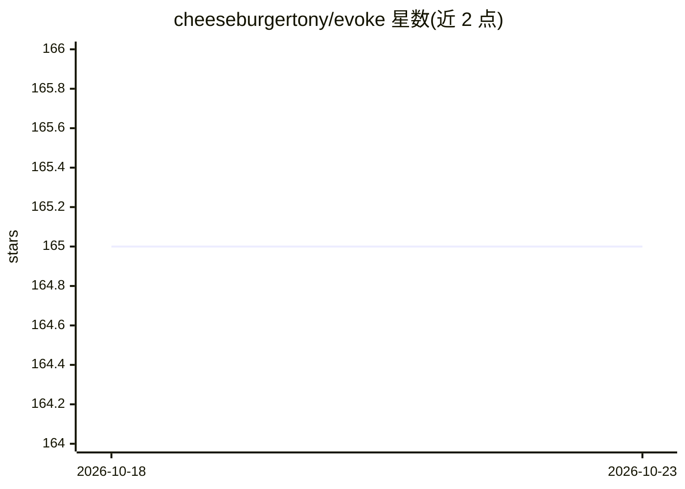

# cheeseburgertony/evoke

⭐ 165 · TypeScript · MIT · 推送 2026-05-31 · [GitHub](https://github.com/cheeseburgertony/evoke) · [官网](https://evoke-mocha.vercel.app) · 个人维护 · 中文 README

**用自然语言对话生成完整 Web 应用并实时预览的平台**

基于 Next.js 16/React 19/TypeScript 的 AI 代码生成平台：用户以自然语言描述需求，Inngest Agent Kit 编排 AI 代理生成应用代码，E2B 沙箱执行并在浏览器实时预览，附带语法高亮的代码浏览器、项目模板、多轮对话迭代、多模型选择与 Clerk 认证的云端项目存储。自部署需 Node.js 18+、Neon PostgreSQL、Clerk、E2B、Inngest 账户及 AI 模型 API 密钥，通过 git clone + npm 安装运行。

## 筛选速览

| 维度 | 判定 | 备注 |
|---|---|---|
| AI 角色 | `ai-native` | 本体是模型或模型工具 |
| 许可风险 | `permissive` | MIT |
| 部署形态 | `library` | 以包/库形式分发 |
| 模型依赖 | — | README 未给出锁定关系 |
| 硬件要求 | — | 无带数字的原话,不猜 |
| 安装摩擦 | `low` | 无编译、无系统依赖或容器化 |
| 成熟度 | — | 结构信号不足 |

## 能力要点

- 自然语言生成 Web 应用代码并实时预览
- E2B 沙箱隔离执行生成的代码
- 代码浏览器支持语法高亮与文件树导航
- 多模型选择与多轮对话迭代优化

## 适用场景

- 描述想法快速生成可运行的 Web 应用原型
- 通过持续对话迭代调整已生成的应用
- 浏览和学习 AI 生成的代码实现

## 场景标签

`代码生成` · 领域:编码与开发

## 证据(README 行号)

> L21: Evoke 是一个 AI 驱动的代码生成平台，通过自然语言对话将你的想法转化为功能完整的 Web 应用程序。只需描述你想要构建的内容，即可实时查看 AI 生成并运行的应用程序。
> L38: - **AI 代码生成** - 用自然语言描述你的应用，AI 自动生成代码
> L122: 2. **AI 处理** - Inngest 编排 AI 代理生成应用代码

## 星数曲线

2026-10-18 165 → 2026-10-23 165（+0）

---
*卡片 v1 · prompt 1.4 · 生成 2026-10-22 · 置信度 high · 依据 README sha `2283cada3fec` · [字段定义](../../DATASET.md)*
