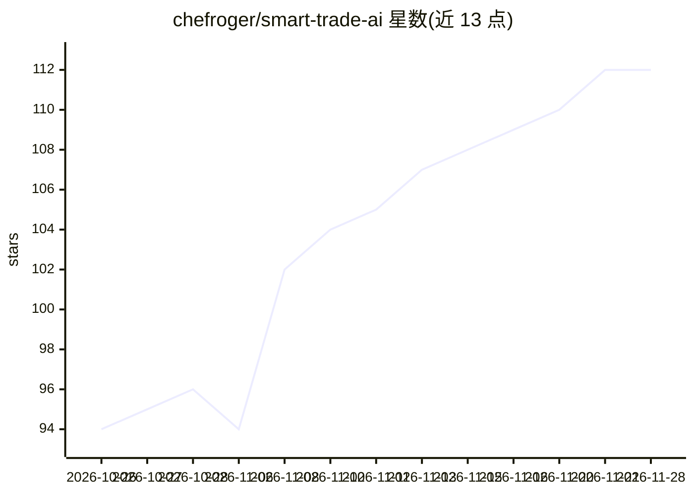

# chefroger/smart-trade-ai

⭐ 112 · Python · AGPL-3.0 · 推送 2026-11-27 · [GitHub](https://github.com/chefroger/smart-trade-ai) · [官网](https://chefroger.github.io/smart-trade-ai/) · 个人维护 · 中文 README

**外贸业务员的本地 AI 助手：45 项 B2B 技能覆盖开发到合规**

基于 FastAPI + SQLite 的本地桌面/服务端应用，进程内嵌 Hermes Agent 作为 AI 引擎，通过浏览器聊天界面（127.0.0.1:9119）交付 45 个 B2B 技能：客户背调 6 层验证、开发信生成、B2B 平台诊断、海关数据分析、文档生成、招标监控等。需用户提供 LLM API Key（推荐 DeepSeek）与 Tavily 搜索 Key；业务数据存于本地 ~/.trade/。许可证为 AGPL v3，含 30 天试用与付费激活码机制，部分功能激活后才显示。

## 筛选速览

| 维度 | 判定 | 备注 |
|---|---|---|
| AI 角色 | `ai-native` | 本体是模型或模型工具 |
| 许可风险 | `viral` | AGPL-3.0 |
| 部署形态 | `desktop` | 安装包/桌面程序 |
| 模型依赖 | local-ok | 支持本地模型 |
| 硬件要求 | — | 无带数字的原话,不猜 |
| 安装摩擦 | `low` | 无编译、无系统依赖或容器化 |
| 成熟度 | — | 结构信号不足 |

## 能力要点

- 45 个 B2B 技能：客户背调/开发信/海关数据/招标监控/文档生成等
- 本地运行，业务数据默认存储在 ~/.trade/，不上传服务器
- 支持 Hermes 代装、一键脚本、手动安装三种安装方式
- 兼容 OpenAI/Anthropic/GLM/Kimi/Ollama 等 LLM 接口

## 适用场景

- 给海外客户写开发信并做 6 层背调验证
- 定时生成汇率行情早报和 B2B 平台检查提醒
- 批量分析招标公告并整理询价单

## 场景标签

`AI 助手` `AI 写作` · 领域:对话与助手

## 证据(README 行号)

> L11:  外贸业务员的 AI 助手
> L73: > Smart Trade AI 使用 Hermes Agent 作为底层 AI 驱动。你需要去模型厂商那里注册并获取 API Key。
> L330: - **业务数据默认存储在本地**（`~/.trade/`），不上传任何服务器

## 星数曲线

2026-10-26 94 → 2026-11-28 112（+18）

---
*卡片 v1 · prompt 1.4 · 生成 2026-11-28 · 置信度 high · 依据 README sha `0543b0b7ae29` · [字段定义](../../DATASET.md)*
