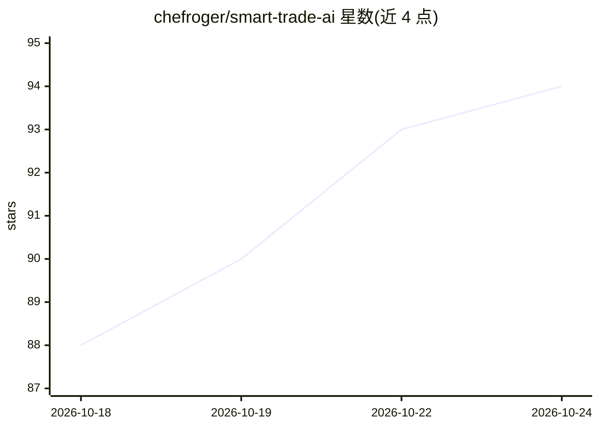

# chefroger/smart-trade-ai

⭐ 94 · Python · AGPL-3.0 · 推送 2026-10-23 · [GitHub](https://github.com/chefroger/smart-trade-ai) · [官网](https://chefroger.github.io/smart-trade-ai/) · 个人维护 · 中文 README

**外贸业务员的本地 AI 助手：客户开发、背调、开发信一站式**

面向国际贸易业务员的桌面级 AI 助手，以 Hermes Agent 为 AI 引擎，在本地运行 FastAPI + SQLite 后端并通过浏览器界面使用。提供 38 项业务能力：客户 6 层背调（邮箱检测/WHOIS/制裁名单等）、开发信与询盘回复生成、B2B 平台诊断、文档分析与商务单证生成、每日简报与定时任务。默认使用 DeepSeek 云端 LLM，也兼容 Ollama 等本地模型实现全本地运行。业务数据默认存储本地，强制 Python 3.14 并要求稳定访问 GitHub/PyPI 的网络环境；README 声明输出仅供参考不构成商业建议或法律依据。

## 筛选速览

| 维度 | 判定 | 备注 |
|---|---|---|
| AI 角色 | `ai-native` | 本体是模型或模型工具 |
| 许可风险 | `viral` | AGPL-3.0 |
| 部署形态 | `library` | 以包/库形式分发 |
| 模型依赖 | local-ok | 支持本地模型 |
| 硬件要求 | — | 无带数字的原话,不猜 |
| 安装摩擦 | `low` | 无编译、无系统依赖或容器化 |
| 成熟度 | `idea` | |

## 能力要点

- 39 个 B2B 技能：客户背调 6 层验证、开发信生成、海关数据分析、客户分级管理
- 文档解析（PDF/Word/Excel/PPT）与报价单/PI/合同生成（DOCX/XLSX/PPTX）
- 业务数据默认本地存储，支持 Ollama 本地模型实现数据不出电脑
- 提供 trade doctor 端到端自检（Hermes 环境/视觉/搜索/对话四项验活）

## 适用场景

- 自动化外贸客户开发：搜索潜客、生成个性化开发信、跟进询盘
- 对客户做尽职调查：邮箱平台检测、WHOIS、制裁名单、LinkedIn 核查
- 维护 B2B 平台与社媒内容：阿里国际站诊断、LinkedIn 内容日历、短视频脚本
- 生成报价单、PI、合同等商务单证并管理数据目录

## 场景标签

`AI 助手` `AI 写作` `文档问答` · 领域:对话与助手

## 证据(README 行号)

> L23:  外贸业务员的 AI 助手
> L49: > Smart Trade AI 使用 Hermes Agent 作为底层 AI 驱动。你需要去模型厂商那里注册并获取 API Key。

## 星数曲线

2026-10-18 88 → 2026-10-24 94（+6）

---
*卡片 v1 · prompt 1.4 · 生成 2026-10-23 · 置信度 high · 依据 README sha `ce6734779fc5` · [字段定义](../../DATASET.md)*
