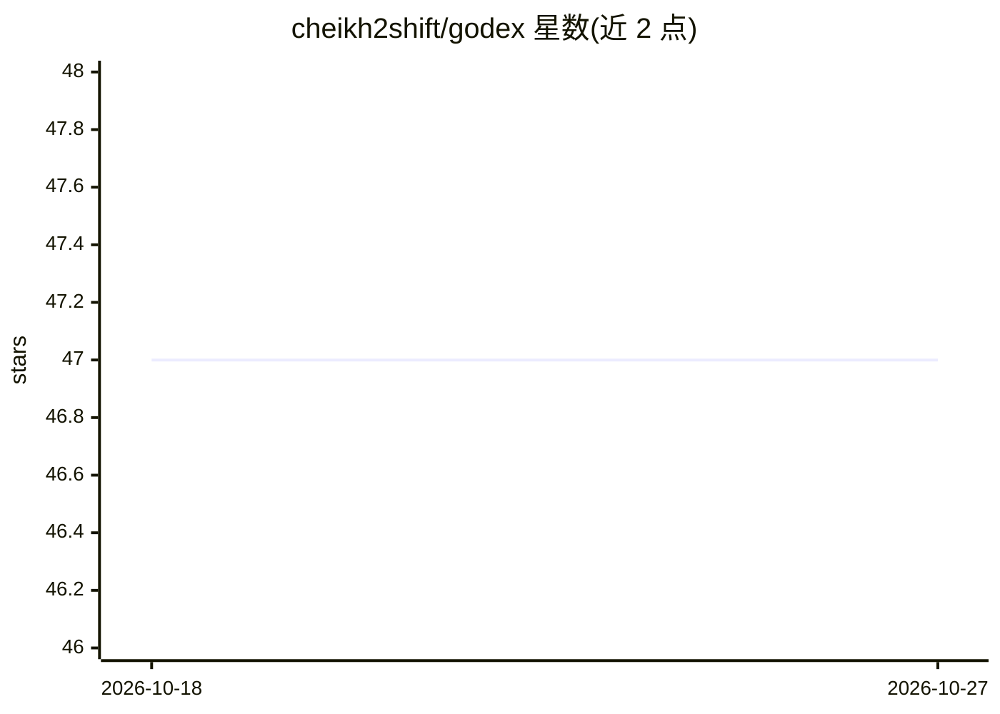

# cheikh2shift/godex

⭐ 47 · Go · GPL-3.0 · 推送 2026-09-02 · [GitHub](https://github.com/cheikh2shift/godex) · 个人维护

**TUI 终端 AI 编程代理，接入多种 LLM 提供商**

GoDex 是用 Go 编写的终端 AI 编程代理，以 TUI 形式运行，支持接入 Ollama、llama.cpp、Gemini、OpenRouter 等提供方，配置存于 ~/.godex/providers.yaml，提供 --wizard 向导。内置 filesystem、bash、webscraper 三个 MCP 服务器，支持外部 MCP 服务器与多实例互联的 Hive 网络模式；提供 CVC 聊天版本控制保存/恢复会话状态。安装途径包括安装脚本、各平台预编译二进制、Docker 沙箱（含 Python/Node/Go/Rust 等工具链与安全隔离）与源码构建。

## 筛选速览

| 维度 | 判定 | 备注 |
|---|---|---|
| AI 角色 | `ai-native` | 本体是模型或模型工具 |
| 许可风险 | `viral` | GPL-3.0 |
| 部署形态 | `desktop` | 安装包/桌面程序 |
| 模型依赖 | local-ok | 支持本地模型 |
| 硬件要求 | — | 无带数字的原话,不猜 |
| 安装摩擦 | `low` | 无编译、无系统依赖或容器化 |
| 成熟度 | — | 结构信号不足 |

## 能力要点

- 接入 Ollama / llama.cpp / Gemini / OpenRouter 等提供方
- 内置 filesystem、bash、webscraper 三个 MCP 服务器
- CVC 聊天版本控制：保存、检索、恢复、合并会话状态
- Hive 网络模式支持多实例互相委派任务

## 适用场景

- 在终端里让 AI 代理读写文件、执行命令、抓取网页来完成编码任务
- 复用本地 Ollama 或 llama.cpp 模型做编程助手
- 通过 Docker 沙箱隔离运行以保护宿主环境

## 场景标签

`编码 Agent` `多智能体` · 领域:Agent 开发

## 证据(README 行号)

> L6: GoDex is an AI coding agent that interfaces with Ollama, llama.cpp, Gemini, OpenRouter (and other LLM providers) thr
> L8: Orchestration and parallel tasks? open another terminal tab and start a new instance of `godex`.
> L198: GoDex supports a Hive network mode where multiple instances can delegate tasks to each other. See HIVE.md for deta

## 星数曲线

2026-10-18 47 → 2026-10-27 47（+0）

---
*卡片 v1 · prompt 1.4 · 生成 2026-10-25 · 置信度 high · 依据 README sha `b9032166c57d` · [字段定义](../../DATASET.md)*
