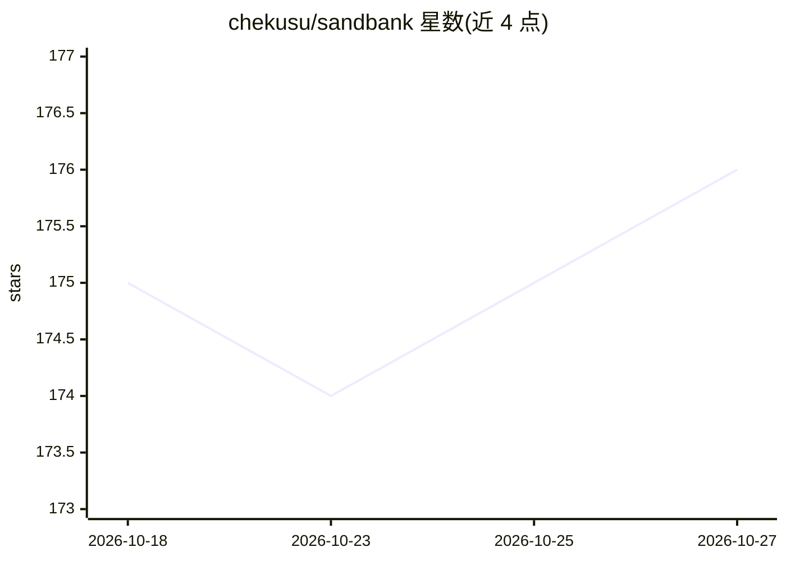

# chekusu/sandbank

⭐ 176 · TypeScript · 推送 2026-09-26 · [GitHub](https://github.com/chekusu/sandbank) · [官网](https://sandbank.dev) · 个人维护 · 中文 README

**面向 AI Agent 的统一 Workspace harness，跨多种沙盒后端调度执行**

Sandbank 把 Agent 身份、memory、artifact、audit log 与 checkpoint 固化在 Workspace 协议中，再通过 provider scheduler 把任务调度到 Sandbank Cloud、E2B、Daytona、Fly.io、Cloudflare Workers、BoxLite 等后端沙盒。提供 Provider SDK 统一不同沙盒 API，包含多 Agent 会话（Relay 消息中继）、Agent Tool Use 权限策略（policy/resource grants/approval rules）、Dynamic Worker 受限 JS code mode，以及 DB-native harness API（默认模型 deepseek-v4-pro）。以 npm/pnpm 包体系分发，MIT 许可。

## 筛选速览

| 维度 | 判定 | 备注 |
|---|---|---|
| AI 角色 | `ai-ecosystem` | LLM/agent 周边工具 |
| 许可风险 | `none` | — |
| 部署形态 | `library` | 以包/库形式分发 |
| 模型依赖 | locked-api |  |
| 硬件要求 | — | 无带数字的原话,不猜 |
| 安装摩擦 | `low` | 无编译、无系统依赖或容器化 |
| 成熟度 | — | 结构信号不足 |

## 能力要点

- Workspace 协议作为 Agent 权威状态边界，支持跨 provider checkpoint 与 sync
- 统一 provider scheduler 按声明能力（runtime.python 等）选择计算后端
- Agent Tool Use 走 supervisor policy 与 resource 白名单，权限边界统一处理
- 多包体系：harness、Provider SDK、Workspace、skills、各沙盒适配器

## 适用场景

- 让 Agent 的长期状态与计算后端解耦，随时切换沙盒 provider
- 对 Agent 工具调用统一施加权限与审批策略
- 多 Agent 在不同沙盒间通过 Relay 实时协作

## 场景标签

`Agent 框架` `多智能体` `Agent 记忆` · 领域:Agent 开发

## 证据(README 行号)

> L5: Sandbank 是面向 AI Agent 的统一 workspace harness。它把 Agent 身份、memory、artifact、audit log、文件和 checkpoint 固化在 `Workspace` 协议里
> L121: Sandbank 的 harness 以 `WorkspaceAdapter` 为 Agent 的权威状态边界。一次 agent run 可以先让模型规划，再用 Dynamic Worker 执行受限 JS code mode，

## 星数曲线

2026-10-18 175 → 2026-10-27 176（+1）

---
*卡片 v1 · prompt 1.4 · 生成 2026-10-23 · 置信度 high · 依据 README sha `97b57aa90541` · [字段定义](../../DATASET.md)*
