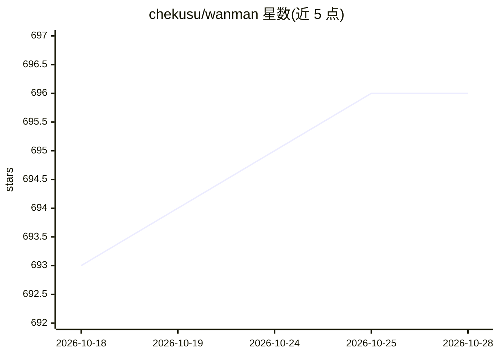

# chekusu/wanman

⭐ 697 · TypeScript · Apache-2.0 · 推送 2026-06-14 · [GitHub](https://github.com/chekusu/wanman) · [官网](http://wanman.ai) · 个人维护

**本地多智能体矩阵运行时：编排 Claude Code/Codex 协同工作**

开源的本地模式 agent 矩阵框架，在用户机器上运行由 Claude Code 或 Codex CLI 子进程组成的多智能体网络，通过 JSON-RPC Supervisor 协调 CEO/dev/devops 等角色，提供异步消息总线、任务池、工件存储与 CLI 命令集。每个 agent 隔离在独立 git worktree 与独立 $HOME 中，需自带已登录的 CLI 凭证；要求 Node 20+ 与 pnpm 9+，从源码克隆安装。另含实验性 FinOps 工具包，wanman.ai 提供云端沙盒版（托管专属能力）。

## 筛选速览

| 维度 | 判定 | 备注 |
|---|---|---|
| AI 角色 | `ai-ecosystem` | LLM/agent 周边工具 |
| 许可风险 | `permissive` | Apache-2.0 |
| 部署形态 | `None` |  |
| 模型依赖 | locked-api |  |
| 硬件要求 | — | 无带数字的原话,不猜 |
| 安装摩擦 | `low` | 无编译、无系统依赖或容器化 |
| 成熟度 | — | 结构信号不足 |

## 能力要点

- 将多个 Claude Code/Codex CLI 子进程编排为受监督的 agent 矩阵
- 每 agent 独立 worktree 与 $HOME 隔离
- JSON-RPC Supervisor 管理消息总线、任务池、上下文与工件存储
- 提供 20+ CLI 命令（send/task/takeover/watch 等），全部可脚本化

## 适用场景

- 在我的仓库上启动一组协作 agent 自动完成开发/运维/营销任务
- 以观察者角色让 agent 矩阵 24/7 自治运行并随时介入调整方向
- 在本地隔离环境中并行运行多个 Claude Code 或 Codex 实例

## 场景标签

`多智能体` `编码 Agent` `Agent 框架` · 领域:Agent 开发

## 证据(README 行号)

> L7: wanman is an open-source local-mode agent matrix framework. Runs a supervised network of Claude Code or Codex agents
> L18: - Runs each agent as a real Claude Code or Codex CLI subprocess — you bring your own CLI auth, wanman orchestrates 

## 星数曲线

2026-10-18 693 → 2026-10-28 696（+3）

---
*卡片 v1 · prompt 1.4 · 生成 2026-10-22 · 置信度 high · 依据 README sha `58cab8afc9b0` · [字段定义](../../DATASET.md)*
