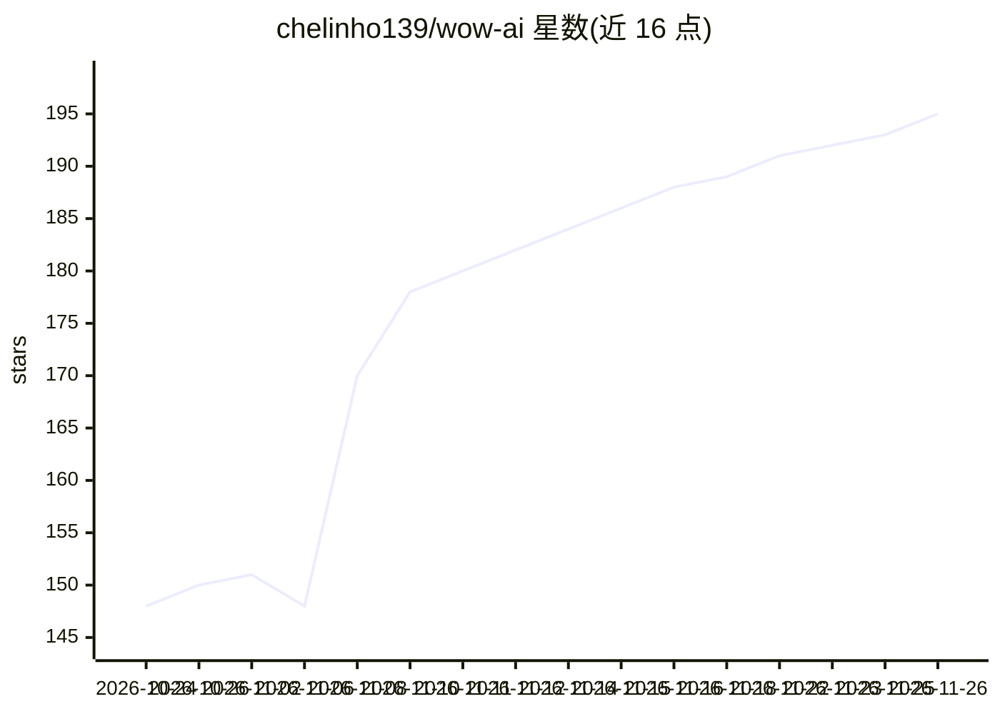

# chelinho139/wow-ai

⭐ 195 · JavaScript · MIT · 推送 2026-11-04 · [GitHub](https://github.com/chelinho139/wow-ai) · 个人维护

**在魔兽世界游戏内与本地编码 Agent 对话的插件+桥接器**

由 WoW 插件与 Node.js 桥接器组成的工具：在游戏内聊天窗口与 Claude Code、Codex、Grok Build、Antigravity、Hermes 等本地编码 Agent CLI 通信。插件因沙箱无网络，通过屏幕角落彩色方块被桥接器每秒截图四次解码传出，回复经 200 个预置槽位插件从磁盘载入传回。支持多聊天并行会话、进度显示、世界地图画路线、宏生成与 Allow & retry 授权。面向想边玩 WoW 边管理编码任务的开发者。

## 筛选速览

| 维度 | 判定 | 备注 |
|---|---|---|
| AI 角色 | `ai-ecosystem` | LLM/agent 周边工具 |
| 许可风险 | `permissive` | MIT |
| 部署形态 | `desktop` | 安装包/桌面程序 |
| 模型依赖 | locked-api |  |
| 硬件要求 | — | 无带数字的原话,不猜 |
| 安装摩擦 | `low` | 无编译、无系统依赖或容器化 |
| 成熟度 | — | 结构信号不足 |

## 能力要点

- 通过屏幕捕获方块与槽位插件文件实现游戏内外双向通信，仅用官方插件 API
- 驱动 Claude Code/Codex/Grok/Antigravity/Hermes 五个本地 Agent CLI，可按聊天切换
- Agent 可读取角色信息、在世界地图绘制编号路线并向导行走
- 支持 Windows、Linux(Wine/X11) 与 macOS 原生客户端三种运行环境

## 适用场景

- 在魔兽世界中向编码 Agent 发任务，打怪时等回复被游戏内提醒
- 多个聊天并行管理不同项目文件夹的 Agent 会话
- 让 Agent 读取角色等级/专业/任务日志并生成游戏宏或地图路线

## 场景标签

`编码 Agent` · 领域:编码与开发

## 证据(README 行号)

> L5: Chat with your local coding agents from inside **World of Warcraft: Forever**: Claude Code, OpenAI Codex, xAI's Grok
> L22: WoW addons are sandboxed: no network, no file reads at runtime. Two doors remain. **Out:** the addon draws your mes
> L29: The bridge drives whichever of these you have installed; each chat can use a different one.

## 星数曲线

2026-10-24 148 → 2026-11-26 195（+47）

---
*卡片 v1 · prompt 1.4 · 生成 2026-11-25 · 置信度 high · 依据 README sha `04defa060eb3` · [字段定义](../../DATASET.md)*
