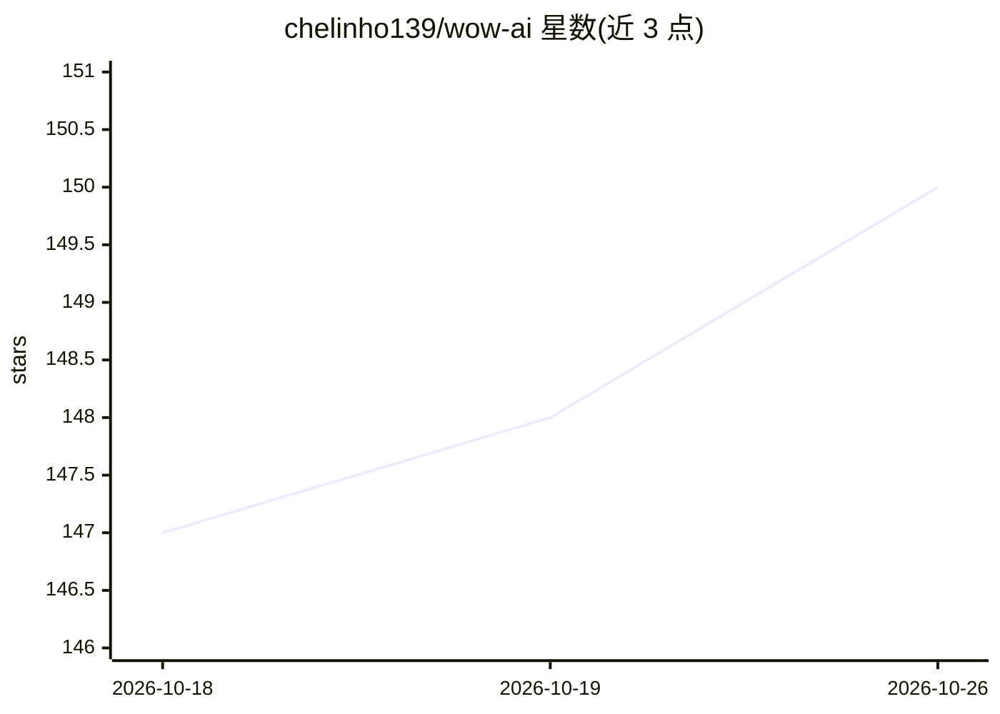

# chelinho139/wow-ai

⭐ 150 · JavaScript · MIT · 推送 2026-09-27 · [GitHub](https://github.com/chelinho139/wow-ai) · 个人维护

**在魔兽世界内聊天驱动本地编程 Agent 的插件**

由游戏内插件、Node.js 桥接进程与屏幕像素通道组成：插件把消息画成屏幕角落的色块条，桥接进程每秒四次截屏解码后，以 headless CLI 方式运行各聊天会话选定的编程 Agent（Claude Code、Codex、Grok Build、Antigravity、Hermes），回复经约 200 个预置槽位插件文件回传游戏内显示。面向边玩边写代码的用户，支持多聊天并行、实时进度、世界地图路线绘制、宏生成等；要求 Node.js 22.2+ 与至少一个已登录的 Agent CLI，窗口须为窗口化/无边框模式。

## 筛选速览

| 维度 | 判定 | 备注 |
|---|---|---|
| AI 角色 | `ai-ecosystem` | LLM/agent 周边工具 |
| 许可风险 | `permissive` | MIT |
| 部署形态 | `desktop` | 安装包/桌面程序 |
| 模型依赖 | locked-api |  |
| 硬件要求 | — | 无带数字的原话,不猜 |
| 安装摩擦 | `low` | 无编译、无系统依赖或容器化 |
| 成熟度 | — | 结构信号不足 |

## 能力要点

- 驱动 5 种编程 Agent CLI，每个聊天可选不同 Agent 与工作目录
- 屏幕色块编码 + 槽位插件文件实现沙箱内双向通信
- Agent 可在世界地图绘制编号路线并在游戏内生成宏
- 支持 Windows、Linux(Wine/X11) 与 macOS 原生客户端

## 适用场景

- 玩游戏的同时给编程 Agent 派发任务，完成时游戏内提醒
- 在游戏内查看 Agent 正在编辑的文件与执行的命令
- 让 Agent 基于角色、任务日志等游戏上下文回答问题

## 场景标签

`编码 Agent` · 领域:编码与开发

## 证据(README 行号)

> L5: Chat with your local coding agents from inside **World of Warcraft: Forever**: Claude Code, OpenAI Codex, xAI's Grok
> L30: |**Claude Code** (`claude`)|`claude -p --output-format stream-json`, resumed with `--resume`|`permissionMode` + `al
> L22: WoW addons are sandboxed: no network, no file reads at runtime. Two doors remain. **Out:** the addon draws your mes

## 星数曲线

2026-10-18 147 → 2026-10-26 150（+3）

---
*卡片 v1 · prompt 1.4 · 生成 2026-10-22 · 置信度 mid · 依据 README sha `6796be8d1373` · [字段定义](../../DATASET.md)*
