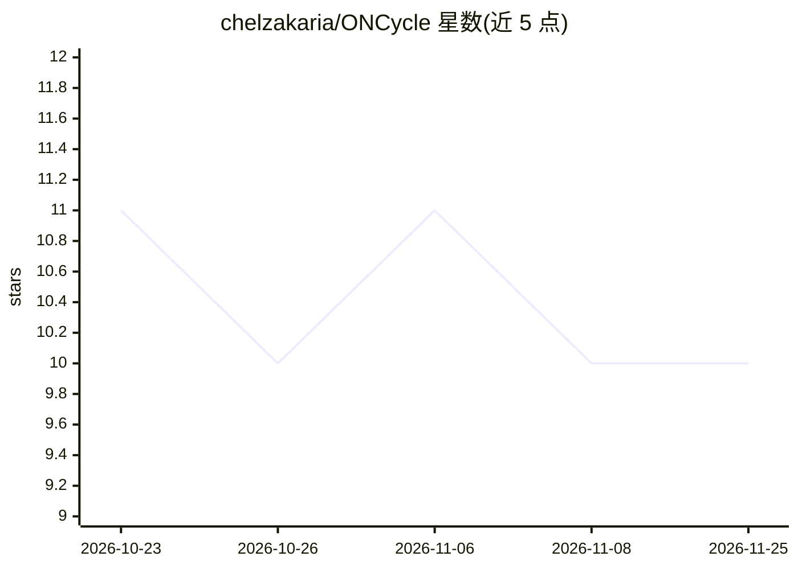

# chelzakaria/ONCycle

⭐ 10 · Jupyter Notebook · MIT · 推送 2026-01-08 · [GitHub](https://github.com/chelzakaria/ONCycle) · [官网](https://www.oncycle.live) · 个人维护

**火车延误实时追踪与 ML 预测平台**

ONCycle 是一个火车延误追踪平台：实时查看列车延误状态、浏览历史延误数据可视化，并基于历史模式用机器学习预测未来延误。后端用 FastAPI 提供 RESTful API，模型端采用 XGBoost（26 个特征、321,269 条训练样本，R² 0.852、MAE 3.62 分钟），特征包括时间、线路属性与历史延误模式；前端为 React/Vite/Tremor，数据存于 PostgreSQL/Supabase，模型定期用新数据再训练。README 未给出安装部署步骤，项目声明为教育与 POC 用途、非官方铁路机构关联产品。

## 筛选速览

| 维度 | 判定 | 备注 |
|---|---|---|
| AI 角色 | `ai-native` | 本体是模型或模型工具 |
| 许可风险 | `permissive` | MIT |
| 部署形态 | `None` |  |
| 模型依赖 | — | README 未给出锁定关系 |
| 硬件要求 | — | 无带数字的原话,不猜 |
| 安装摩擦 | `low` | 无编译、无系统依赖或容器化 |
| 成熟度 | — | 结构信号不足 |

## 能力要点

- 基于 XGBoost 的延误预测（R² 0.852、MAE 3.62 分钟，26 特征）
- 实时延误追踪与历史数据可视化
- FastAPI RESTful API 与模型服务化部署
- 定期以新数据持续再训练并记录模型指标

## 适用场景

- 查询列车实际延误状态与历史延误数据
- 基于历史模式预测列车未来延误时间

## 场景标签

`数据分析` · 领域:效率与自动化

## 证据(README 行号)

> L10: ONCycle is a platform designed to follow the status of trains delays in real-time. It provides users with the abili
> L42: - Modeling: Python, Scikit-learn, XGBoost
> L50: - **Model Experimentation**: Evaluated multiple algorithms; selected XGBoost for its superior performance (high acc

## 星数曲线

2026-10-23 11 → 2026-11-25 10（-1）

---
*卡片 v1 · prompt 1.4 · 生成 2026-11-19 · 置信度 high · 依据 README sha `3afadb03f4f8` · [字段定义](../../DATASET.md)*
