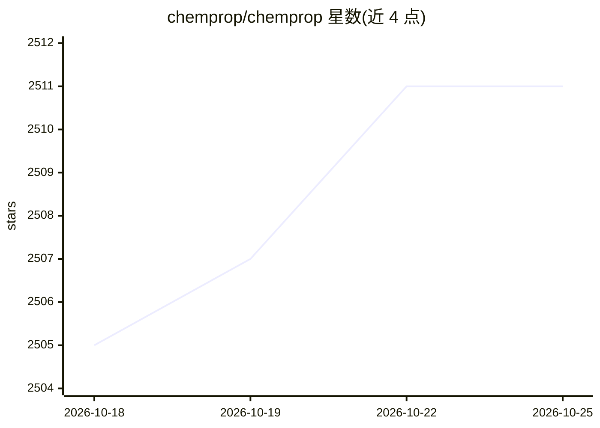

# chemprop/chemprop

⭐ 2,511 · Python · NOASSERTION · 推送 2026-10-21 · [GitHub](https://github.com/chemprop/chemprop) · [官网](https://chemprop.csail.mit.edu) · 组织维护

**用于分子性质预测的消息传递神经网络（MPNN）软件包**

Chemprop 是面向化学与药物发现场景的机器学习软件包，实现消息传递神经网络（MPNN），从分子图（以及反应的缩合图表示）预测化学性质。v2.0.0 完成重写，提供 CLI、文档、examples/ 目录中的教程 notebook 与可解释性示例（基于可解释子结构论文）；包含原子/键级预测功能。已被用于抗生素发现（Halicin、MRSA 选择性抗生素类）与 ADMET-AI 等研究。v1 已停止支持，遗留 bug 标记 v1-wontfix，官方提供 v1→v2 迁移指南。

## 筛选速览

| 维度 | 判定 | 备注 |
|---|---|---|
| AI 角色 | `ai-native` | 本体是模型或模型工具 |
| 许可风险 | `permissive` | NOASSERTION |
| 部署形态 | `library` | 以包/库形式分发 |
| 模型依赖 | — | README 未给出锁定关系 |
| 硬件要求 | — | 无带数字的原话,不猜 |
| 安装摩擦 | `low` | 无编译、无系统依赖或容器化 |
| 成熟度 | — | 结构信号不足 |

## 能力要点

- 基于消息传递神经网络的分子/反应性质预测
- v2 重写提供 CLI、文档与教程 notebook，含可解释性示例
- 原子级与键级预测功能（基于 QM 描述符论文）
- 已用于抗生素发现与 ADMET-AI 等发表研究

## 适用场景

- 训练模型预测分子的化学/生物性质
- 药物发现中筛选与评估候选分子
- 通过可解释性方法分析分子子结构贡献

## 场景标签

 · 领域:化学/药物发现（分子机器学习）

## 证据(README 行号)

> L15: Chemprop is a repository containing message passing neural networks for molecular property prediction.
> L29: - **Theory**: The theory underpinning Chemprop was initially described in the papers Analyzing Learned Molecular Re

## 星数曲线

2026-10-18 2,505 → 2026-10-25 2,511（+6）

---
*卡片 v1 · prompt 1.4 · 生成 2026-10-21 · 置信度 high · 依据 README sha `add00d403647` · [字段定义](../../DATASET.md)*
