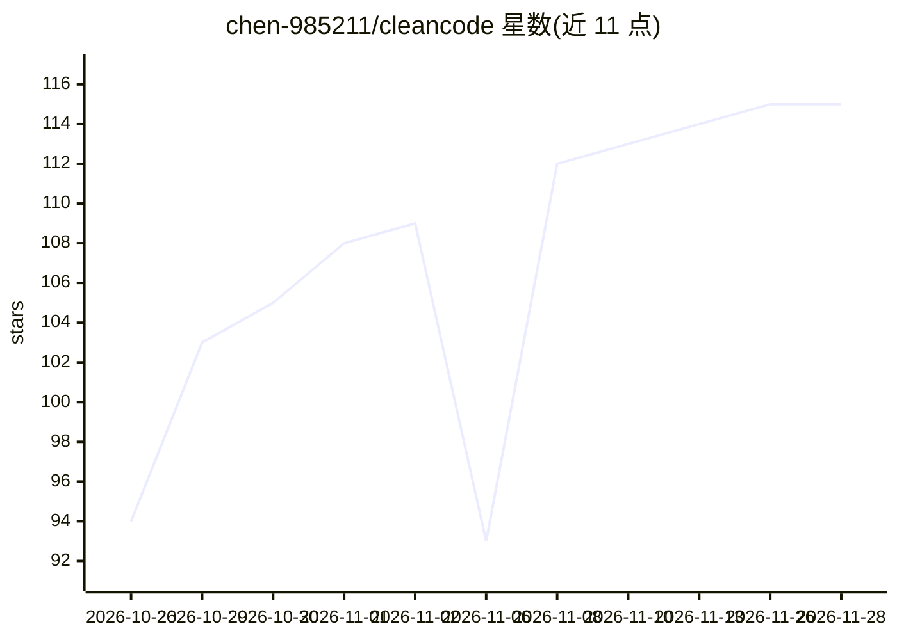

# chen-985211/cleancode

⭐ 115 · TypeScript · MIT · 推送 2026-11-27 · [GitHub](https://github.com/chen-985211/cleancode) · 个人维护 · 中文 README

**让人类与多个 AI 编码代理在画布上协作的 ADE**

CleanCode 是一个画布式 ADE（Agentic Development Environment），将 Agent、终端和项目工作空间整合到一个画布上。用户表达意图并在画布上观察、选择和调整结果；Agent 在其工具和权限范围内执行分析、规划、脚本编写和故障排除等任务。内置 33 种编码代理 CLI 的启动配置（含 Claude Code、Codex、Gemini 等），自动检测本机已安装的工具。支持通过 MCP 让 Agent 操纵画布、构建工作流并创建其他 Agent，并使用 Git worktrees 为每个分支提供独立的工作空间。目前以 Preview 版本分发（macOS/Windows/Linux），尚未完成 Apple 公证和开发者签名。

## 筛选速览

| 维度 | 判定 | 备注 |
|---|---|---|
| AI 角色 | `ai-ecosystem` | LLM/agent 周边工具 |
| 许可风险 | `permissive` | MIT |
| 部署形态 | `library` | 以包/库形式分发 |
| 模型依赖 | — | README 未给出锁定关系 |
| 硬件要求 | — | 无带数字的原话,不猜 |
| 安装摩擦 | `low` | 无编译、无系统依赖或容器化 |
| 成熟度 | `idea` | |

## 能力要点

- 支持 33 种 Agent CLI 在同一画布上运行，包括 Claude Code 和 Codex
- 原生 CleanCode MCP 使 Agent 能够操纵画布并构建工作流
- 基于 Git worktrees 的分支工作空间实现多任务并行开发
- 支持带有依赖项的自动化工作流，连接终端命令、脚本和非交互式 AI CLI

## 适用场景

- 在一块画布上同时运行 Claude Code 和 Codex 以处理同一个项目
- 并行开发多个 Git 分支，每个分支拥有独立的终端和 Agent 会话
- 通过连接依赖关系的终端步骤来自动化任务工作流

## 场景标签

`编码 Agent` `多智能体` `工作流自动化` · 领域:Agent 开发

## 证据(README 行号)

> L34: **CleanCode is a canvas ADE (Agentic Development Environment) for human–AI collaboration.** It brings Agents, termi
> L46: - 🤖 **Multiple Agents**: Use 33 Agent CLIs, including Codex and Claude Code, with notifications from some tools whe
> L51: - ⚙️ **Automated Workflows**: Connect terminal commands, scripts, and non-interactive AI CLIs, run them according t

## 星数曲线

2026-10-26 94 → 2026-11-28 115（+21）

---
*卡片 v1 · prompt 1.4 · 生成 2026-11-28 · 置信度 high · 依据 README sha `8a6bfe6f0b52` · [字段定义](../../DATASET.md)*
