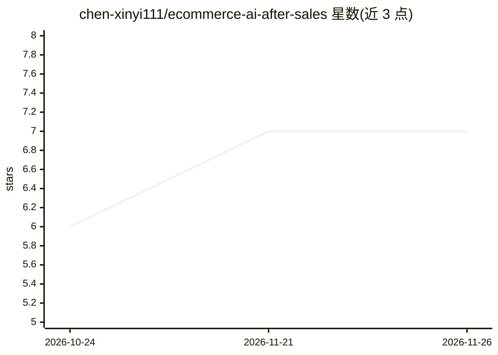

# chen-xinyi111/ecommerce-ai-after-sales

⭐ 7 · Python · MIT · 推送 2026-10-14 · [GitHub](https://github.com/chen-xinyi111/ecommerce-ai-after-sales) · 个人维护 · 中文 README

**给电商用户与客服的 AI 售后咨询审批工作台**

一套面向用户与客服的电商售后服务应用，将订单查询、AI 咨询、售后申请、人工协作与客服审批串联在同一工作台，覆盖退款、换货、补发、维修四类售后场景。技术栈为 Vue 3 前端 + FastAPI 服务接口，LangGraph 编排问题识别、订单核验、政策判断和方案生成等子图，工具访问经 MCP 边界并按角色白名单约束；数据存 PostgreSQL，异步任务经 SSE 推进度，支持 Kafka/Redis。当前使用模拟订单、支付、库存、物流，未接入真实企业系统。基于 agent-service-toolkit 扩展，保留 MIT 许可。

## 筛选速览

| 维度 | 判定 | 备注 |
|---|---|---|
| AI 角色 | `ai-native` | 本体是模型或模型工具 |
| 许可风险 | `permissive` | MIT |
| 部署形态 | `self-host` | docker 或自建部署 |
| 模型依赖 | — | README 未给出锁定关系 |
| 硬件要求 | — | 无带数字的原话,不猜 |
| 安装摩擦 | `low` | 无编译、无系统依赖或容器化 |
| 成熟度 | — | 结构信号不足 |

## 能力要点

- LangGraph 编排问题识别、订单核验、政策判断与方案生成子图
- AI 咨询关联订单开展多轮对话，结合物流、库存、历史售后与政策生成方案
- 人工协作转接客服时暂停助手自动回复，审批与执行流程分离
- 默认离线模拟模型，无需 API Key，Docker Compose 一键本机运行

## 适用场景

- 本机演示一套含 AI 咨询与人工审批的售后全流程
- 用户按步骤提交售后申请并跟踪办理结果
- 客服在待办工作台核对材料并审批退款换货请求

## 场景标签

`聊天机器人` `AI 助手` · 领域:对话与助手

## 证据(README 行号)

> L16: |AI 咨询|关联订单开展多轮咨询，结合订单、物流、库存、历史售后与政策信息生成建议和方案。|
> L44: |Agent 编排|LangGraph：组织问题识别、订单核验、政策判断和方案生成等专职子图。|

## 星数曲线

2026-10-24 6 → 2026-11-26 7（+1）

---
*卡片 v1 · prompt 1.4 · 生成 2026-11-20 · 置信度 mid · 依据 README sha `9a40d5f4b8ce` · [字段定义](../../DATASET.md)*
