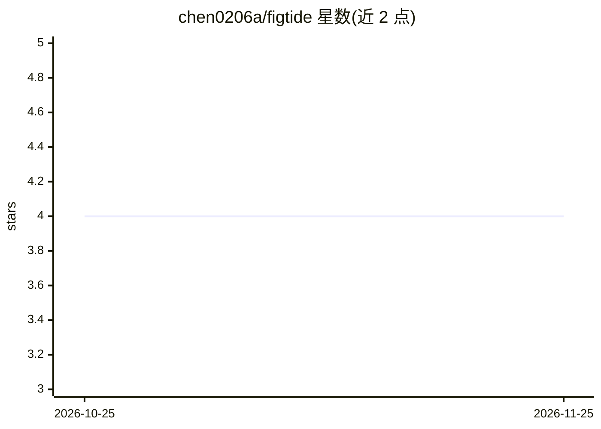

# chen0206a/figtide

⭐ 4 · TypeScript · MIT · 推送 2026-11-02 · [GitHub](https://github.com/chen0206a/figtide) · [官网](https://chen0206a.github.io/figtide/) · 个人维护 · 中文 README

**给 AI/ML 研究者的本地科研数据管理与论文绘图工作台**

本地运行的实验数据管理与科研绘图桌面应用：导入 CSV/XLSX/JSON 等格式并保存不可变原始版本与内容指纹，支持折线、箱线、ROC、混淆矩阵等十余种图型，按论文物理尺寸导出 SVG/PNG/矢量 PDF。核心绘图导出功能无需模型服务；可选绘图助手通过兼容 Chat Completions 的接口推荐图型并生成绘图配置，自研 Java Agent Harness 实现工具校验、修改提案、用户确认、预算控制与审计；另提供可选 MCP Server 供 Claude Desktop、Codex、Cursor 等读取脱敏字段画像并修改图表。当前仅交付 Windows 便携 ZIP。

## 筛选速览

| 维度 | 判定 | 备注 |
|---|---|---|
| AI 角色 | `ai-enhanced` | 去掉 AI 部分产品仍成立 |
| 许可风险 | `permissive` | MIT |
| 部署形态 | `desktop` | 安装包/桌面程序 |
| 模型依赖 | — | README 未给出锁定关系 |
| 硬件要求 | — | 无带数字的原话,不猜 |
| 安装摩擦 | `medium` | 含编译或系统依赖之一 |
| 成熟度 | — | 结构信号不足 |

## 能力要点

- 不可变原始数据保存、内容指纹与派生数据机制
- 十余种科研图型与按论文尺寸导出 SVG/PNG/嵌入字体矢量 PDF
- 可选绘图助手：自研 Java Agent Harness，工具校验、提案确认、预算控制与审计
- 可选 MCP Server 向 Claude Desktop/Codex/Cursor 提供脱敏字段画像与图表修改

## 适用场景

- 把实验记录的原始数据整理成可复现的论文插图
- 本地管理多实验参数、指标与对比，不把数据上传云端
- 用自然语言描述需求让助手生成并确认绘图配置
- 通过 MCP 让 Claude Code/Cursor 读写本地项目图表

## 场景标签

`科研工具` · 领域:学习与行业

## 证据(README 行号)

> L3: 面向 AI / 机器学习研究者的本地实验数据管理与科研绘图工作台，从原始数据到可复现的论文图表。
> L31: - 可选绘图助手：网页配置兼容模型接口，测试基础对话与工具调用，根据字段摘要推荐图型，用户选定后继续绘图。
> L39: FigTide 运行在你的电脑上。数据、图表和所有版本都保存在本机，我们没有用于接收这些数据的云端服务器，也不收集任何使用数据。只有在你配置模型并勾选同意后，绘图助手才会把图表配置和字段摘要发给你选择的模型服务，不会附带原始数据行

## 星数曲线

2026-10-25 4 → 2026-11-25 4（+0）

---
*卡片 v1 · prompt 1.4 · 生成 2026-11-21 · 置信度 high · 依据 README sha `72c10a2430b1` · [字段定义](../../DATASET.md)*
