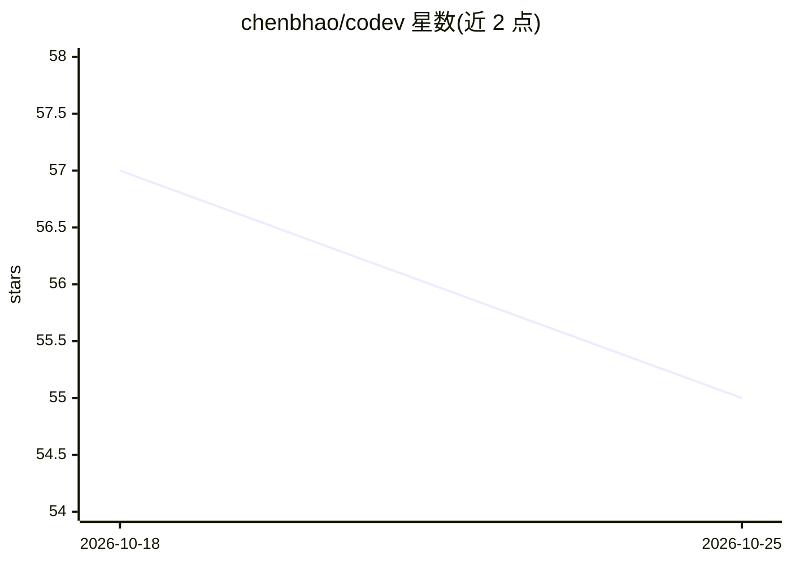

# chenbhao/codev

⭐ 55 · TypeScript · 推送 2026-07-18 · [GitHub](https://github.com/chenbhao/codev) · [官网](https://x.com/chenbhao) · 个人维护 · 中文 README

**终端里的多 Agent 协作编程工作区 CLI（TypeScript）**

基于 TypeScript/Bun 的终端 AI 编程代理工作区：以 TUI 形式提供 WebSearch/WebFetch、浏览器控制、语音输入输出（Groq Whisper STT、Edge/Qwen TTS）、Tmux 后端多 Agent 团队协作，以及 Explore/Plan/Verification 子代理拓扑完成多步任务分解。核心机制包括 Auto Compact 上下文压缩、Dream 长期记忆蒸馏、Telegram/飞书网关与 Tauri 桌面端。模型接入通过 OpenRouter 免费通道与本地模型文件系统 provider，本地搜索依赖 SearXNG 或 Tavily API key。安装方式为脚本一键安装。

## 筛选速览

| 维度 | 判定 | 备注 |
|---|---|---|
| AI 角色 | `ai-ecosystem` | LLM/agent 周边工具 |
| 许可风险 | `none` | — |
| 部署形态 | `None` |  |
| 模型依赖 | locked-api |  |
| 硬件要求 | — | 无带数字的原话,不猜 |
| 安装摩擦 | `low` | 无编译、无系统依赖或容器化 |
| 成熟度 | — | 结构信号不足 |

## 能力要点

- Explore/Plan/Verification 子代理拓扑做多步任务分解
- Auto Compact 上下文压缩与 Dream 长期记忆蒸馏支撑长会话
- Tmux 后端的多 Agent 团队协作与动态扩缩
- Groq Whisper STT 与 Edge/Qwen TTS 语音链路

## 适用场景

- 在终端用多个子代理完成端到端开发任务
- 长会话持续开发时自动压缩上下文并沉淀记忆
- 通过 Telegram 或飞书接收消息并语音交互

## 场景标签

`编码 Agent` `多智能体` `Agent 记忆` · 领域:Agent 开发

## 证据(README 行号)

> L29: - **2026-06-02** 🤝 Agent Team — Multi-agent collaboration via Tmux backend with teammate layout manager, dynamic te
> L30: - **2026-06-01** 🧩 SubAgent Swarm Topology — Dedicated Explore 🔍, Plan 📋, and Verification 🧪 subagents for autonomo
> L121: - Auto Compact — Automatically optimizes and compresses historical context to bypass sequence length bottlenecks.

## 星数曲线

2026-10-18 57 → 2026-10-25 55（-2）

---
*卡片 v1 · prompt 1.4 · 生成 2026-10-24 · 置信度 mid · 依据 README sha `85d55062aba5` · [字段定义](../../DATASET.md)*
