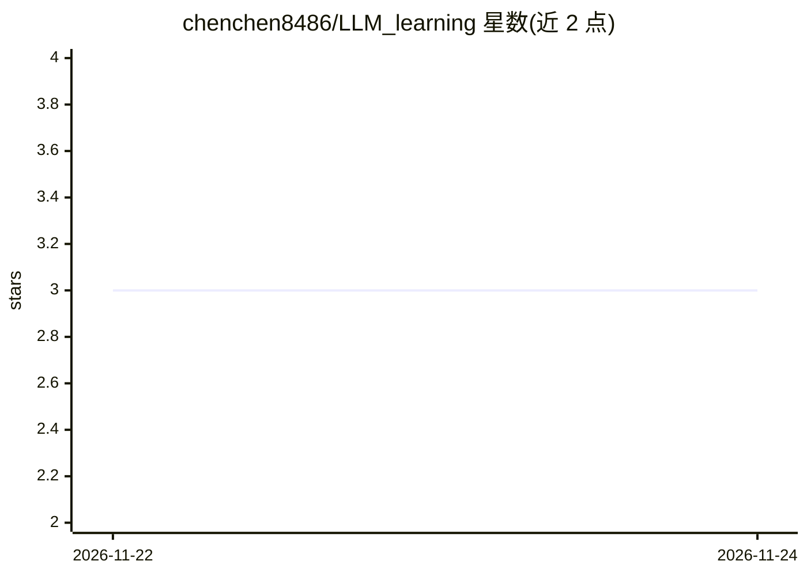

# chenchen8486/LLM_learning

⭐ — · [GitHub]() · 个人维护 · 中文 README

**给中文学习者的离线 LLM 机制手册：15 章全链路讲解**

一套中文大语言模型机制学习手册，覆盖训练数据、分词、词向量与位置编码、Transformer 架构、预训练、中间训练、后训练、推理部署、应用范式与多模态扩展共 15 章，另有 15 节数学附录。内容以公式推导、SVG 示意图与开源项目 minimind 的 PyTorch 代码对照组织，各章注明论文与技术报告出处。构建产物随仓库发布，可在线阅读，也可克隆仓库后用浏览器打开 HTML；支持文字高亮、标注导入导出与本地书签（存于浏览器 localStorage）。

## 筛选速览

| 维度 | 判定 | 备注 |
|---|---|---|
| AI 角色 | `ai-knowledge` | 知识聚合/清单类 |
| 许可风险 | `none` | — |
| 部署形态 | `None` |  |
| 模型依赖 | — | README 未给出锁定关系 |
| 硬件要求 | — | 无带数字的原话,不猜 |
| 安装摩擦 | `low` | 无编译、无系统依赖或容器化 |
| 成熟度 | — | 结构信号不足 |

## 能力要点

- 15 章 + 15 节附录覆盖 LLM 训练到部署全生命周期
- 关键机制配有原创 SVG 示意图与公式推导
- 部分机制与开源项目 minimind 的 PyTorch 实现逐行对照
- 支持在线阅读与本地 HTML 浏览，标注与书签仅存本地

## 适用场景

- 系统学习大语言模型从预训练到推理部署的机制
- 阅读 Transformer 注意力等论文时配合示意图与代码对照理解
- 离线环境下查阅中文 LLM 学习资料

## 场景标签

`教程课程` · 领域:学习与行业

## 证据(README 行号)

> L10:  本项目是一套中文大语言模型（LLM）机制学习手册，内容覆盖训练数据、分词、词向量与位置编码、Transformer 架构、预训练、中间训练、后训练、推理部署、应用范式及多模态扩展。手册结合公式推导、原创 SVG 示意图与开源代码
> L20: - 生命周期主线：第 0 章至第 15 章依次介绍数据、分词、词向量与位置编码、模型架构、预训练、中间训练、后训练、推理与后处理、部署优化、应用范式及多模态扩展。
> L35:  各章由若干独立页面组成，页面统一设置快速浏览、正文讲解、示意图、要点回顾和参考来源。第 4 章以 Attention 原论文译文为依据，其余章节以原始论文和官方技术报告为主要依据，并在页面末尾列明出处。

## 星数曲线

2026-11-22 3 → 2026-11-24 3（+0）

---
*卡片 v1 · prompt 1.4 · 生成 2026-11-22 · 置信度 high · 依据 README sha `0dd6203ec585` · [字段定义](../../DATASET.md)*
