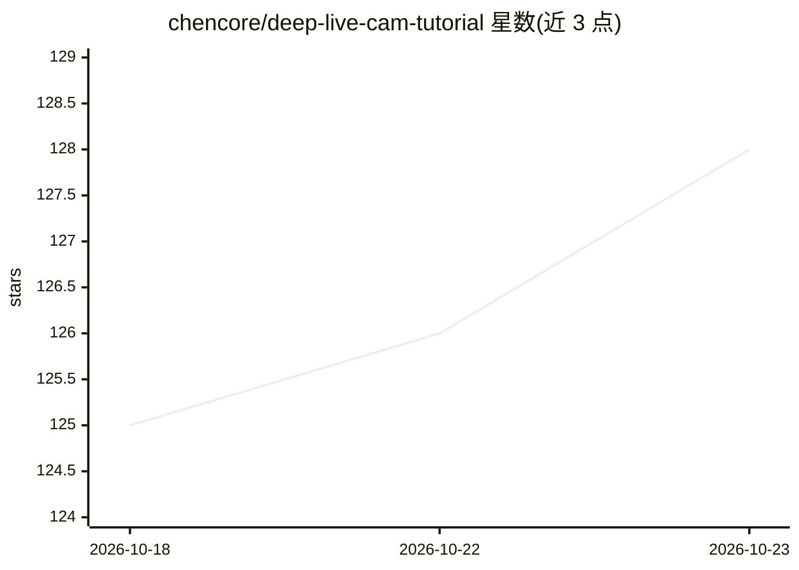

# chencore/deep-live-cam-tutorial

⭐ 128 · 推送 2026-04-04 · [GitHub](https://github.com/chencore/deep-live-cam-tutorial) · 个人维护 · 中文 README

**Deep-Live-Cam 实时换脸工具的中文安装使用教程**

面向中文用户的 Deep-Live-Cam（hacksider 开源实时人脸替换工具）第三方使用指南：覆盖 Windows/macOS/Linux 三平台的源码安装步骤（Python 3.11、虚拟环境、HuggingFace 模型下载、CUDA/CoreML 加速配置），以及直播换脸操作流程、Mouth Mask/多人换脸/GFPGAN 面部增强等高级功能说明、常见问题排查、不同硬件的 FPS 性能参考表与道德法律提示。本仓库本身为文档，不包含工具代码。

## 筛选速览

| 维度 | 判定 | 备注 |
|---|---|---|
| AI 角色 | `ai-knowledge` | 知识聚合/清单类 |
| 许可风险 | `none` | — |
| 部署形态 | `library` | 以包/库形式分发 |
| 模型依赖 | — | README 未给出锁定关系 |
| 硬件要求 | — | 无带数字的原话,不猜 |
| 安装摩擦 | `medium` | 含编译或系统依赖之一 |
| 成熟度 | — | 结构信号不足 |

## 能力要点

- Windows/macOS/Linux 三平台安装步骤与 GPU 加速配置说明
- 操作流程三步（选脸/选摄像头/点击 Live）与参数说明
- Mouth Mask、多人换脸、GFPGAN 面部增强等高级功能说明
- 各配置档位的 FPS 性能参考表与常见问题排查

## 适用场景

- 我想按中文教程在本地装好 Deep-Live-Cam 做直播换脸
- 遇到模型加载失败或 FPS 低的问题时查排查方法
- 了解换脸工具的硬件配置要求与性能预期

## 场景标签

`教程课程` · 领域:学习与行业

## 证据(README 行号)

> L1: # Deep-Live-Cam 完整安装与使用教程
> L7: Deep-Live-Cam 是一个开源的实时人脸替换工具。
> L71: git clone https://github.com/hacksider/Deep-Live-Cam.git

## 星数曲线

2026-10-18 125 → 2026-10-23 128（+3）

---
*卡片 v1 · prompt 1.4 · 生成 2026-10-23 · 置信度 low · 依据 README sha `d397dc015602` · [字段定义](../../DATASET.md)*
