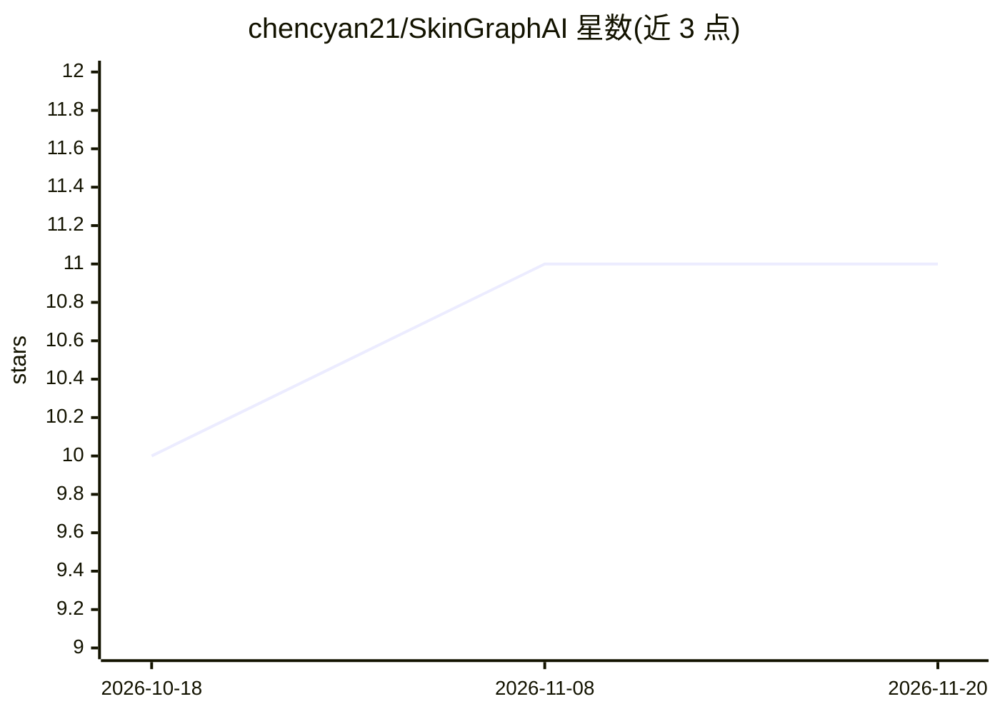

# chencyan21/SkinGraphAI

⭐ 11 · Python · Apache-2.0 · 推送 2026-07-28 · [GitHub](https://github.com/chencyan21/SkinGraphAI) · 个人维护

**皮肤病镜图像分析的多 agent 演示工作流，带人工审核**

以离线演示形式连接皮肤镜图像门控、结构化 SkinVL 风格输出、证据感知解释、LangGraph 人工审批/编辑/拒绝环节与输出防护。默认的图像路由、SkinVL 输出与 RAG 证据均为确定性模拟，无需模型权重、数据集、Qdrant、Ollama 或网络；可选 extras 提供真实 RAG、SkinVL 适配器与 Tavily 网页搜索。提供 FastAPI 接口与 Chainlit 审核界面，支持 Docker 部署。声明为教学性工程演示，不含临床验证。

## 筛选速览

| 维度 | 判定 | 备注 |
|---|---|---|
| AI 角色 | `ai-native` | 本体是模型或模型工具 |
| 许可风险 | `permissive` | Apache-2.0 |
| 部署形态 | `self-host` | docker 或自建部署 |
| 模型依赖 | local-ok | 支持本地模型 |
| 硬件要求 | — | 无带数字的原话,不猜 |
| 安装摩擦 | `low` | 无编译、无系统依赖或容器化 |
| 成熟度 | `idea` | |

## 能力要点

- 每张支持的图像分析均需人工 approve/edit/reject 后才返回
- 默认确定性模拟后端，可离线运行，无需模型权重与外部服务
- 可选 extras：RAG（Docling/Ollama/Qdrant）、真实 SkinVL 适配器、Tavily 搜索
- FastAPI 端点（/chat /upload /validate）与 Chainlit UI，支持 Docker

## 适用场景

- 演示带人工审核环节的医学图像分析工作流
- 离线体验皮肤镜问答与审批/编辑/拒绝流程
- 作为接入真实 SkinVL、RAG 与网页搜索后端的工程骨架

## 场景标签

`多智能体` `聊天机器人` `RAG` · 领域:Agent 开发

## 证据(README 行号)

> L3: SkinGraph AI is a small, end-to-end demonstration of a safe dermoscopy workflow. It connects image gating, structure
> L9: - Dermoscopy image analysis with structured findings
> L79: In the Chainlit page, send a text question or attach a PNG/JPG/JPEG dermoscopy image. Supported image requests paus

## 星数曲线

2026-10-18 10 → 2026-11-20 11（+1）

---
*卡片 v1 · prompt 1.4 · 生成 2026-11-18 · 置信度 high · 依据 README sha `4bee64c29935` · [字段定义](../../DATASET.md)*
