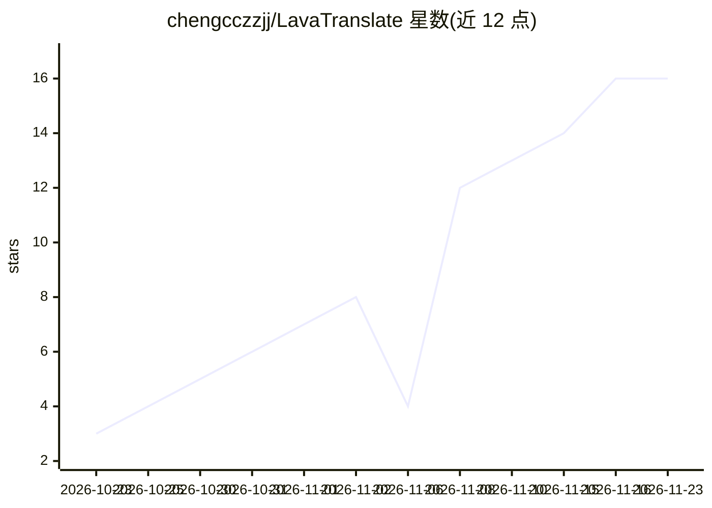

# chengcczzjj/LavaTranslate

⭐ 16 · TypeScript · MIT · 推送 2026-11-21 · [GitHub](https://github.com/chengcczzjj/LavaTranslate) · 个人维护 · 中文 README

**截图原位翻译与母语回复外语聊天的桌面/安卓应用**

覆盖 Windows、Android 与 Apple Silicon Mac 的截图翻译应用：框选屏幕区域后在原位置叠加译文，保留原文的字号、颜色、粗细与对齐，图标不被覆盖。OCR 本地运行（Windows 尝试 DirectML，回退 CPU；Mac 用 CPU），再由视觉模型纠错、合并折行并保留代码/URL/品牌名不译。附回复助手：用母语输入，模型结合屏幕对话生成外语回复并提供回译。翻译服务需用户自行接入（ChatGPT 账号登录或粘贴 Gemini/OpenAI/DeepSeek/Qwen/智谱/Kimi/豆包/OpenRouter 等 API key）。Windows 安装包未签名，Mac 构建为 ad-hoc 签名未经公证。

## 筛选速览

| 维度 | 判定 | 备注 |
|---|---|---|
| AI 角色 | `ai-native` | 本体是模型或模型工具 |
| 许可风险 | `permissive` | MIT |
| 部署形态 | `desktop` | 安装包/桌面程序 |
| 模型依赖 | locked-api |  |
| 硬件要求 | — | 无带数字的原话,不猜 |
| 安装摩擦 | `low` | 无编译、无系统依赖或容器化 |
| 成熟度 | `idea` | |

## 能力要点

- 译文按原位置、字号、颜色、粗细、对齐原位叠加
- 本地 OCR（DirectML/CPU）+ 视觉模型纠错与折行合并
- 回复助手：母语输入生成外语回复，附回译与语气选择
- 支持 ChatGPT 账号登录或多家 API key 自动识别接入

## 适用场景

- 阅读外语文档、网页或界面并获得原位翻译
- 在外语聊天中用母语撰写回复并粘贴发送
- 安卓上整屏原位翻译并随翻页自动重译
- 输入文字即时翻译成外语（双击快捷键打字翻译）

## 场景标签

`OCR` · 领域:感知与多模态

## 证据(README 行号)

> L5:  Select any part of your screen — the translation appears right on top of it, in the same layout.
> L62: - **The model looks at the screenshot itself.** OCR runs locally; a vision model then fixes recognition errors, mer
> L103: - **ChatGPT Plus / Pro** — click **用 ChatGPT 登录 (Sign in with ChatGPT)**. Translations use your plan's usage inste

## 星数曲线

2026-10-23 3 → 2026-11-23 16（+13）

---
*卡片 v1 · prompt 1.4 · 生成 2026-11-18 · 置信度 mid · 依据 README sha `a9bbf4978db6` · [字段定义](../../DATASET.md)*
