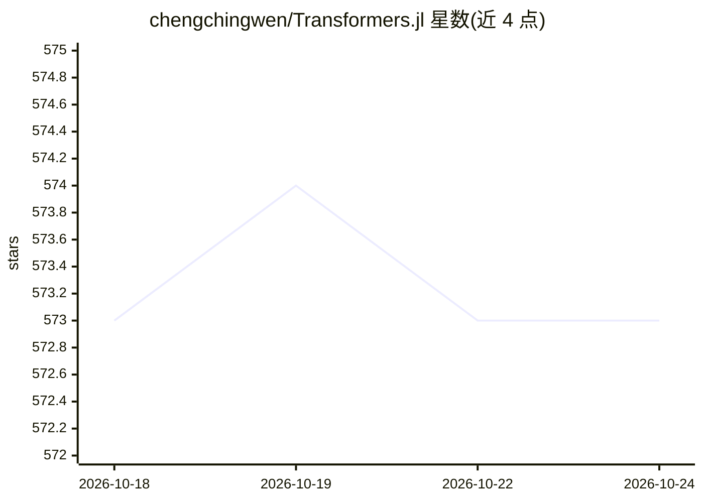

# chengchingwen/Transformers.jl

⭐ 573 · Julia · MIT · 推送 2026-10-24 · [GitHub](https://github.com/chengchingwen/Transformers.jl) · 个人维护

**Julia 语言基于 Flux.jl 的 Transformer 模型实现库**

面向 Julia 开发者的 Transformer 模型库，基于 Flux.jl 构建，支持加载 HuggingFace 预训练模型（如 BERT）进行文本编码与推理。README 提供一个使用预训练 BERT 的 Julia 示例，并指向 example 文件夹的完整示例。当前版本与 0.1.x 几乎完全不同，旧版本用户需迁移或继续使用旧版。通过 Julia REPL 的包管理器安装，支持渠道含 codecov 与 build status 徽章所示 CI。

## 筛选速览

| 维度 | 判定 | 备注 |
|---|---|---|
| AI 角色 | `ai-native` | 本体是模型或模型工具 |
| 许可风险 | `permissive` | MIT |
| 部署形态 | `None` |  |
| 模型依赖 | — | README 未给出锁定关系 |
| 硬件要求 | — | 无带数字的原话,不猜 |
| 安装摩擦 | `low` | 无编译、无系统依赖或容器化 |
| 成熟度 | — | 结构信号不足 |

## 能力要点

- 基于 Flux.jl 的 Julia Transformer 模型实现
- 支持加载 HuggingFace 预训练模型（示例为 BERT）
- 提供 TextEncoders 等模块与 example 文件夹完整示例

## 适用场景

- 在 Julia 项目中加载预训练 BERT 做文本任务
- 用 Flux.jl 生态构建/微调 Transformer 模型

## 场景标签

 · 领域:机器学习/NLP

## 证据(README 行号)

> L6: Julia implementation of transformer-based models, with Flux.jl.
> L18: Using pretrained Bert with `Transformers.jl`.

## 星数曲线

2026-10-18 573 → 2026-10-24 573（+0）

---
*卡片 v1 · prompt 1.4 · 生成 2026-10-21 · 置信度 high · 依据 README sha `4826193504d9` · [字段定义](../../DATASET.md)*
