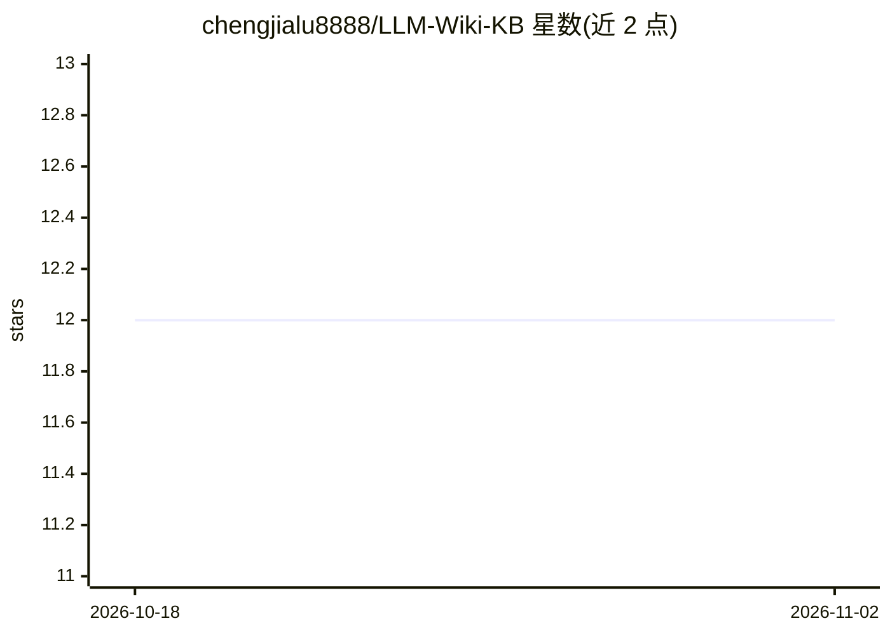

# chengjialu8888/LLM-Wiki-KB

⭐ 12 · Python · MIT · 推送 2026-04-07 · [GitHub](https://github.com/chengjialu8888/LLM-Wiki-KB) · 个人维护 · 中文 README

**把 Karpathy 的 LLM Wiki 蓝图实现为 LLM Agent 可用的知识库工具链**

基于 Andrej Karpathy 2025 年 LLM Wiki Gist 的实现项目：提供 5 个 Python CLI 工具（init/ingest/query/search/lint），将 URL 或本地文件转为 Markdown 原始素材，由 LLM Agent 按 5 种结构化页面类型（Source/Entity/Concept/Comparison/Synthesis）编译为持续积累的 Wiki 知识库，并支持导出 Markdown、Marp 幻灯片、飞书文档和图表。适配 Claude Code、OpenCode、字节内部 Mira 三套平台，深度集成 Obsidian。带 35 项端到端测试。面向使用 LLM Agent 做知识管理的研究者与开发者。

## 筛选速览

| 维度 | 判定 | 备注 |
|---|---|---|
| AI 角色 | `ai-ecosystem` | LLM/agent 周边工具 |
| 许可风险 | `permissive` | MIT |
| 部署形态 | `library` | 以包/库形式分发 |
| 模型依赖 | — | README 未给出锁定关系 |
| 硬件要求 | — | 无带数字的原话,不猜 |
| 安装摩擦 | `low` | 无编译、无系统依赖或容器化 |
| 成熟度 | — | 结构信号不足 |

## 能力要点

- 5 个 Python CLI 工具：init / ingest / query / search / lint
- 5 种结构化页面类型及 YAML frontmatter 模板
- 3 套平台适配器（Claude Code / OpenCode / Mira）与 Obsidian 深度集成
- 导出飞书文档 / Marp 幻灯片 / 研究报告 / Matplotlib 图表

## 适用场景

- 让 Claude Code / OpenCode 等 Agent 把网页和文献沉淀为个人 Wiki 知识库
- 研究者长期积累领域知识并导出幻灯片或飞书文档分享
- 通过 /wiki lint 维护知识库健康度（死链接、孤儿页面）

## 场景标签

`知识库管理` `科研工具` · 领域:知识与检索

## 证据(README 行号)

> L41: **LLM Wiki KB 把 Karpathy 的蓝图变成了一套即插即用的工具链。**
> L157: │                   Your LLM Agent                     │
> L165: 2. **Wiki（知识编译）** — LLM 阅读原始素材，按 5 种页面类型模板编写 Wiki 页面，存入 `wiki/`，更新 `index.md` 和 `log.md`

## 星数曲线

2026-10-18 12 → 2026-11-02 12（+0）

---
*卡片 v1 · prompt 1.4 · 生成 2026-11-01 · 置信度 high · 依据 README sha `8961f063d811` · [字段定义](../../DATASET.md)*
