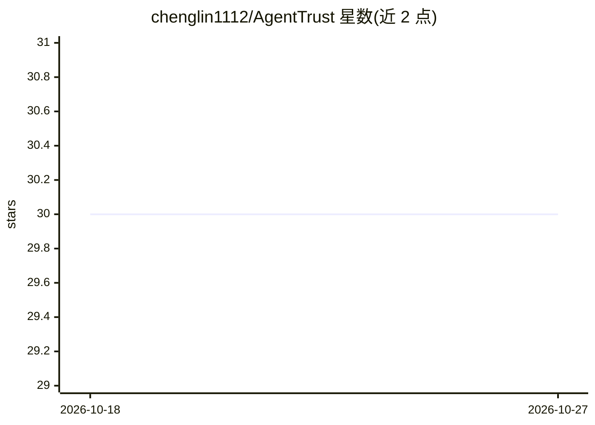

# chenglin1112/AgentTrust

⭐ 30 · Python · AGPL-3.0 · 推送 2026-09-01 · [GitHub](https://github.com/chenglin1112/AgentTrust) · [官网](https://arxiv.org/abs/2605.04785) · 个人维护

**工具型 AI agent 的执行前安全门禁与能力控制框架**

部署在 agent 与其工具之间的确定性规则门：在动作执行前拦截受规则覆盖的危险操作（凭证读取、rm -rf、DROP DATABASE、受保护分支强推等），内置 42 个风险模式、174 条策略规则；被拦截时给出 SafeFix 更安全替代，会话级检测多步攻击链（7 个链式模式），可选开启默认关闭的 LLM judge 处理模糊案例，其裁决可蒸馏为新规则形成自学习。以 Python 包（pip/git 源码）安装，支持 MCP 集成；规则路径中位延迟约 0.3ms。面向 agent 开发者、安全研究者与 DevOps 团队；设计上不判定意图，仅约束操作本身。

## 筛选速览

| 维度 | 判定 | 备注 |
|---|---|---|
| AI 角色 | `ai-ecosystem` | LLM/agent 周边工具 |
| 许可风险 | `dual` | AGPL-3.0 |
| 部署形态 | `self-host` | docker 或自建部署 |
| 模型依赖 | — | README 未给出锁定关系 |
| 硬件要求 | — | 无带数字的原话,不猜 |
| 安装摩擦 | `low` | 无编译、无系统依赖或容器化 |
| 成熟度 | `idea` | |

## 能力要点

- 执行前确定性门禁：42 个风险模式、174 条策略规则、约 0.3ms 中位延迟
- SafeFix 为被拦截动作建议更安全替代（37 条修复规则）
- 会话级 RiskChain 检测多步攻击链（7 个链式模式）
- 可选（默认关闭）LLM judge：OpenAI/Anthropic/DeepSeek，裁决可自学习蒸馏为新规则

## 适用场景

- 阻止 AI 编程 agent 执行 rm -rf、DROP DATABASE 等不可逆操作
- 通过 MCP 集成在团队内强制执行 agent 最小权限能力边界
- 安全研究者用 300 个基准场景测试规则门覆盖率与误报率

## 场景标签

`网络安全` `模型评测` · 领域:评测与运维

## 证据(README 行号)

> L7: AgentTrust is a sub-millisecond **rule gate** that sits between an agent and its tools and enforces a policy over ru
> L88: |**Team lead / DevOps**|Enforce a deterministic capability floor across AI agents via MCP integration|
> L159: |**LLMJudge**|Cache-aware semantic evaluation for ambiguous cases|5 risk dims · OpenAI / Anthropic / DeepSeek|

## 星数曲线

2026-10-18 30 → 2026-10-27 30（+0）

---
*卡片 v1 · prompt 1.4 · 生成 2026-10-26 · 置信度 mid · 依据 README sha `262256d4489d` · [字段定义](../../DATASET.md)*
