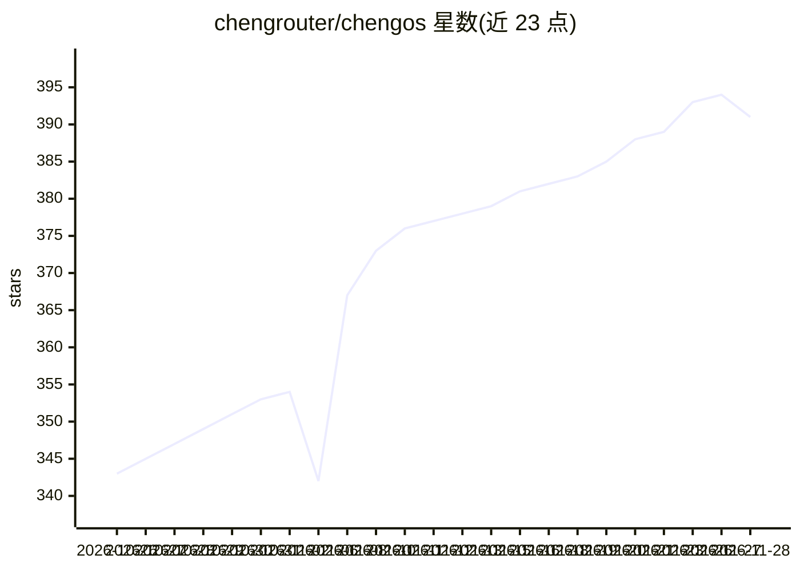

# chengrouter/chengos

⭐ 391 · Shell · 推送 2026-11-24 · [GitHub](https://github.com/chengrouter/chengos) · [官网](https://chengos.dev) · 组织维护 · 中文 README

**面向开发者的可视化 AI 工作流与智能体构建运行平台**

ChengOS 是一个可视化平台，用于构建、运行和发布 AI 工作流与智能体，整合 Rust DAG 工作流引擎、浏览器端工作流编辑器、多渠道聊天应用、终端客户端与统一部署工具。核心机制包括：React Flow 画布编排、ReAct 智能体多步工具调用、原生 MCP 连接（Stdio/SSE/HTTP）、多格式 Skill 导入（自然语言/网页/Git 仓库/SKILL.md/ZIP）、后端凭证仓库隔离与沙箱、本地文档表格 RAG 管线。提供 Windows 桌面安装包、原生与 Docker Compose 部署。当前免费使用但源代码不公开。

## 筛选速览

| 维度 | 判定 | 备注 |
|---|---|---|
| AI 角色 | `ai-ecosystem` | LLM/agent 周边工具 |
| 许可风险 | `none` | — |
| 部署形态 | `desktop` | 安装包/桌面程序 |
| 模型依赖 | — | README 未给出锁定关系 |
| 硬件要求 | — | 无带数字的原话,不猜 |
| 安装摩擦 | `low` | 无编译、无系统依赖或容器化 |
| 成熟度 | — | 结构信号不足 |

## 能力要点

- React Flow 可视化工作流编排与 ReAct 智能体多步工具调用
- 原生 MCP 支持：通过 mcp_hub 以 Stdio/SSE/HTTP 连接 MCP 服务
- 多格式 Skill 导入（自然语言、网页/API 文档、Git 仓库、SKILL.md、ZIP）与热加载
- 凭证后端隔离与沙箱；本地 docx/xlsx 与 RAG 节点（分块/索引/检索/向量搜索）

## 适用场景

- 搭建可发布到 Web、H5/PWA、WhatsApp/Telegram/Slack/企业微信/钉钉等渠道的聊天应用
- 编排本地文档、表格与 RAG 的自动化数据处理流程
- 用终端 CLI 连接本地或远程服务器与智能体对话
- 部署带版本更新与回滚机制的生产环境服务

## 场景标签

`工作流自动化` `RAG` `Agent 框架` · 领域:Agent 开发

## 证据(README 行号)

> L21: ChengOS is a visual platform for building, running, and publishing AI workflows and agents. It combines a Rust work
> L32: - ReAct agents that can discover and invoke tools, MCP servers, and Skills.
> L216: ChengOS is currently **free to use but not open source**. It may be used for personal and commercial office automa

## 星数曲线

2026-10-26 343 → 2026-11-28 391（+48）

---
*卡片 v1 · prompt 1.4 · 生成 2026-11-25 · 置信度 high · 依据 README sha `00fdf27b4618` · [字段定义](../../DATASET.md)*
