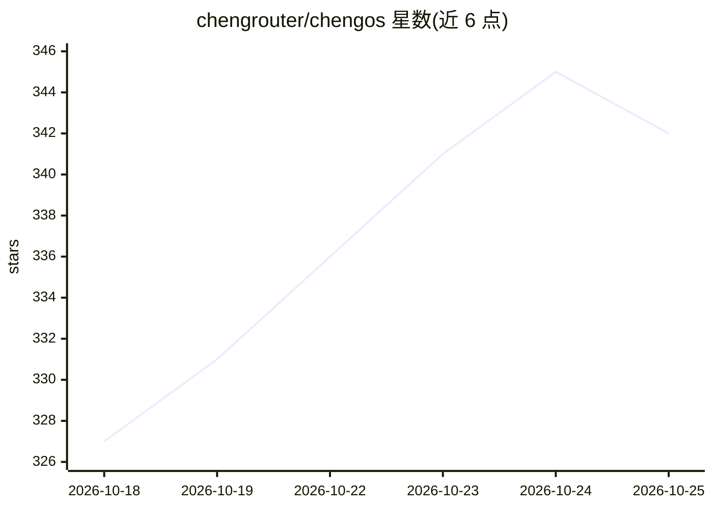

# chengrouter/chengos

⭐ 342 · Shell · 推送 2026-10-17 · [GitHub](https://github.com/chengrouter/chengos) · [官网](https://chengos.dev) · 组织维护 · 中文 README

**可视化 AI 工作流与智能体构建/运行/发布平台**

ChengOS 整合 Rust 工作流引擎、浏览器端可视化编辑器、多渠道聊天应用、终端 CLI 与统一部署脚本，面向构建、运行和发布 AI 工作流与 ReAct 智能体的场景。关键机制包括：原生 MCP 支持（Stdio/SSE/HTTP）、多格式 Skill 导入、后端凭证隔离与沙箱、本地文档/表格/RAG 节点，以及含校验和签名校验的更新回滚流程。支持原生与 Docker Compose 部署，捆绑 PostgreSQL、Valkey、Qdrant。限制：免费使用但源码不公开（非开源）。

## 筛选速览

| 维度 | 判定 | 备注 |
|---|---|---|
| AI 角色 | `ai-ecosystem` | LLM/agent 周边工具 |
| 许可风险 | `none` | — |
| 部署形态 | `self-host` | docker 或自建部署 |
| 模型依赖 | — | README 未给出锁定关系 |
| 硬件要求 | — | 无带数字的原话,不猜 |
| 安装摩擦 | `low` | 无编译、无系统依赖或容器化 |
| 成熟度 | — | 结构信号不足 |

## 能力要点

- React Flow 画布编排工作流，含子工作流与批量并行
- 原生 MCP 支持（Stdio/SSE/HTTP 连接）与多格式 Skill 导入
- 凭证存后端仓库、执行时下发，沙箱与 user_id 隔离
- 内置本地 Word/表格工作区与 RAG 节点（分块/索引/检索）

## 适用场景

- 在可视化画布上搭建并发布 AI 自动化工作流
- 通过 Web/H5/消息渠道或终端 CLI 与智能体对话
- 本地文档、表格与 RAG 数据处理，不依赖第三方在线办公平台

## 场景标签

`工作流自动化` `Agent 框架` · 领域:Agent 开发

## 证据(README 行号)

> L21: ChengOS is a visual platform for building, running, and publishing AI workflows and agents. It combines a Rust work
> L40: - ReAct agents that can discover and invoke tools, MCP servers, and Skills.

## 星数曲线

2026-10-18 327 → 2026-10-25 342（+15）

---
*卡片 v1 · prompt 1.4 · 生成 2026-10-21 · 置信度 high · 依据 README sha `19542e3631c8` · [字段定义](../../DATASET.md)*
