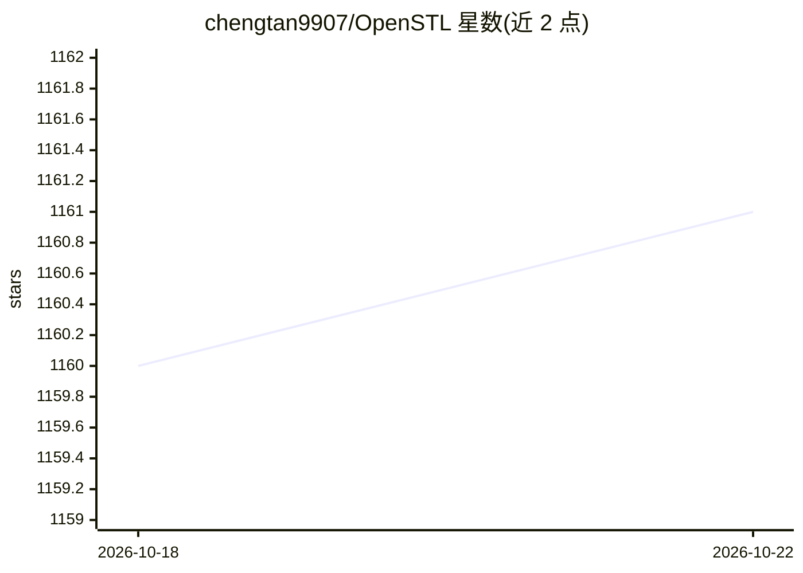

# chengtan9907/OpenSTL

⭐ 1,161 · Python · Apache-2.0 · 推送 2026-03-01 · [GitHub](https://github.com/chengtan9907/OpenSTL) · [官网](https://openstl.readthedocs.io/en/latest/) · 组织维护

**时空预测学习基准框架：统一训练评测视频/交通/气象预测方法**

面向时空预测学习（STL）的综合性基准与模块化框架，覆盖 ConvLSTM、PredRNN 系列、SimVP、TAU 等 14 种视频预测方法及 11 种 MetaFormer 骨干，支持 Moving MNIST、KTH、TaxiBJ、WeatherBench 等 9 个数据集，任务从合成运动轨迹到人体动作、驾驶场景、交通流与气象预报。代码分 core/algorithm/UI 三层，提供 PyTorch Lightning 版本（OpenSTL-Lightning，推荐）与原生 PyTorch 版本，通过 tools/train.py 与 test.py 统一实验流程，并附自定义数据教程与 Colab demo。由西湖大学 CAIRI AI Lab 研究者维护，NeurIPS 2023 D&B Track 论文，Apache 2.0 许可。

## 筛选速览

| 维度 | 判定 | 备注 |
|---|---|---|
| AI 角色 | `ai-native` | 本体是模型或模型工具 |
| 许可风险 | `permissive` | Apache-2.0 |
| 部署形态 | `None` |  |
| 模型依赖 | — | README 未给出锁定关系 |
| 硬件要求 | — | 无带数字的原话,不猜 |
| 安装摩擦 | `low` | 无编译、无系统依赖或容器化 |
| 成熟度 | — | 结构信号不足 |

## 能力要点

- 收录 14 种时空预测方法与 11 种 MetaFormer 骨干
- 支持 9 个标准数据集（Moving MNIST/TaxiBJ/WeatherBench 等）
- OpenSTL-Lightning（PyTorch Lightning 实现，推荐）与原生 PyTorch 双版本
- 提供自定义数据训练教程与 Colab demo

## 适用场景

- 对比评测时空/视频预测方法的标准基准
- 在自己的视频、交通或气象数据上训练预测模型
- 研究者在统一框架下开发新的 STL 算法

## 场景标签

`模型评测` · 领域:评测与运维

## 证据(README 行号)

> L1: # OpenSTL: A Comprehensive Benchmark of Spatio-Temporal Predictive Learning
> L26: OpenSTL is a comprehensive benchmark for spatio-temporal predictive learning, encompassing a broad spectrum of meth

## 星数曲线

2026-10-18 1,160 → 2026-10-22 1,161（+1）

---
*卡片 v1 · prompt 1.4 · 生成 2026-10-21 · 置信度 high · 依据 README sha `0046da00e90f` · [字段定义](../../DATASET.md)*
