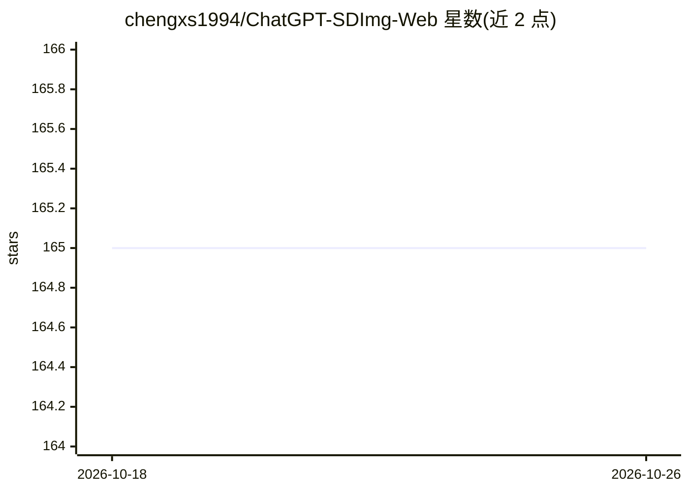

# chengxs1994/ChatGPT-SDImg-Web

⭐ 165 · PHP · NOASSERTION · 推送 2026-08-13 · [GitHub](https://github.com/chengxs1994/ChatGPT-SDImg-Web) · [官网](https://xsai.online) · 个人维护 · 中文 README

**自托管 ChatGPT 对话 + SD 绘图 Web 应用模板，带账号与计费**

基于 ChatGPT-Next-Web 的自托管 AI Web 应用：在 ChatGPT 问答之外集成 Stable Diffusion WebUI 绘图、AI 视频生成、AI 二维码，并提供用户注册登录、个人中心、次数限制、积分充值、邀请码与邀请链接分享、后台管理等功能。通过环境变量配置 OPENAI_API_KEY、BASE_URL 等，支持本地开发（Node.js 18 + Yarn）与 pm2、Vercel、Docker 部署。适合学习、二次开发和验证 AI 应用前后端集成方式。

## 筛选速览

| 维度 | 判定 | 备注 |
|---|---|---|
| AI 角色 | `ai-native` | 本体是模型或模型工具 |
| 许可风险 | `none` | NOASSERTION |
| 部署形态 | `None` |  |
| 模型依赖 | — | README 未给出锁定关系 |
| 硬件要求 | — | 无带数字的原话,不猜 |
| 安装摩擦 | `low` | 无编译、无系统依赖或容器化 |
| 成熟度 | — | 结构信号不足 |

## 能力要点

- ChatGPT 问答与 SD WebUI 绘图集成
- 用户注册登录、次数限制与积分充值
- 邀请码/邀请链接分享机制
- AI 二维码、AI 视频生成、后台管理功能

## 适用场景

- 自建带账号和额度控制的 ChatGPT 绘图站
- 学习 AI Web 应用的前后端集成与部署
- 二次开发验证计费/分享类 AI 应用功能

## 场景标签

`聊天机器人` `图像生成` `视频生成` · 领域:对话与助手

## 证据(README 行号)

> L15: ChatGPT SDImg Web 是一个面向自托管场景的 AI Web 应用模板，在 ChatGPT 对话能力之外集成 Stable Diffusion WebUI 绘图、用户账号、次数/积分限制、分享和部署配置。项目适合用于学
> L33: - ChatGPT问答
> L34: - SD webUI AI绘画

## 星数曲线

2026-10-18 165 → 2026-10-26 165（+0）

---
*卡片 v1 · prompt 1.4 · 生成 2026-10-22 · 置信度 high · 依据 README sha `75193f7408ff` · [字段定义](../../DATASET.md)*
