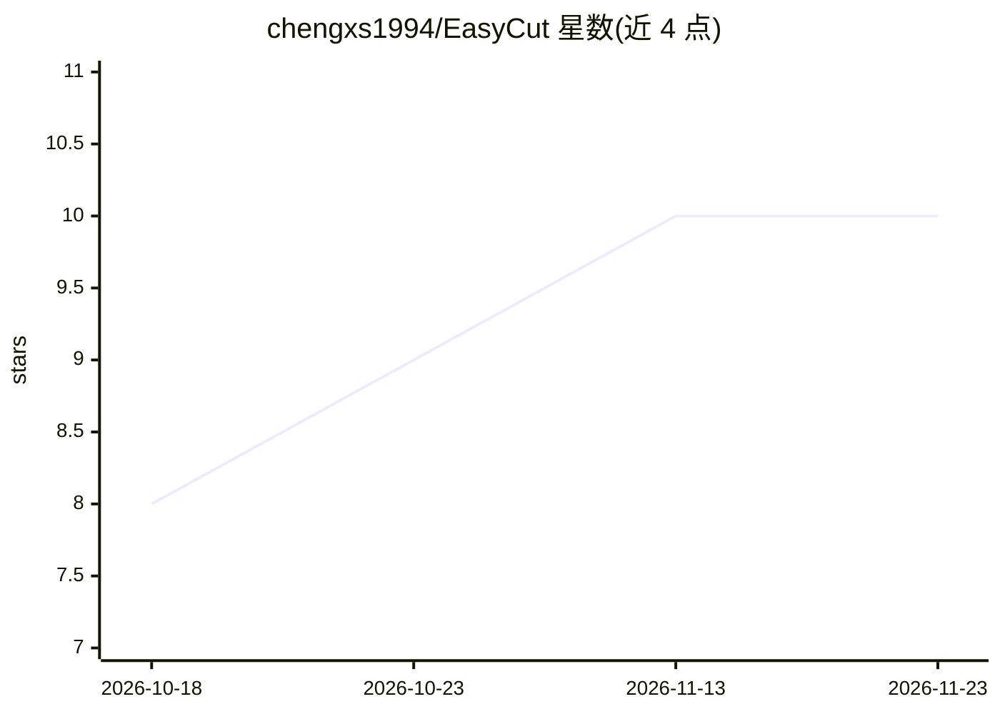

# chengxs1994/EasyCut

⭐ 10 · JavaScript · NOASSERTION · 推送 2026-10-23 · [GitHub](https://github.com/chengxs1994/EasyCut) · [官网](https://chengxs1994.github.io/EasyCut/) · 个人维护 · 中文 README

**纯浏览器本地视频剪辑器，可经 AI Skill 自然语言生成草稿**

以原生 HTML/CSS/JavaScript 构建的纯浏览器视频编辑器，双击 index.html 即可运行，无需后端，素材不上传。功能覆盖多轨道剪辑、文字样式、贴纸/画中画、特效转场、草稿自动保存至 IndexedDB 或本地文件夹、MP4/MOV 导出。AI 相关部分有三处：经 jianyi-editor Skill 由外部 AI 助手把自然语言转为 JSON 配置并调用 CLI 生成本地草稿；以及需另行部署本地 ai-video-service 与模型的自动字幕、文字配音、声音克隆、人声/伴奏分离（该部分代码尚未同步到 main）。使用 Skill/CLI 需 Node.js 18.3+。

## 筛选速览

| 维度 | 判定 | 备注 |
|---|---|---|
| AI 角色 | `ai-enhanced` | 去掉 AI 部分产品仍成立 |
| 许可风险 | `none` | NOASSERTION |
| 部署形态 | `None` |  |
| 模型依赖 | — | README 未给出锁定关系 |
| 硬件要求 | — | 无带数字的原话,不猜 |
| 安装摩擦 | `low` | 无编译、无系统依赖或容器化 |
| 成熟度 | `idea` | |

## 能力要点

- 纯浏览器运行，无后端，素材不上传，草稿存 IndexedDB 或本地文件夹
- AI Skill：自然语言需求经外部 AI 助手转配置，调用 CLI 生成可继续编辑的草稿
- 结构化 CLI 支持 create/update/open 与 --open 直接进入网页调优
- 本地 AI 音频工具：自动字幕、文字配音、zero-shot 声音克隆、Demucs 人声分离

## 适用场景

- 在浏览器里直接剪辑、加字幕贴纸并导出 MP4，素材不出本机
- 用自然语言让 AI 助手生成剪辑草稿，再在网页里调优导出
- 本地部署 ai-video-service 后做自动字幕与人声/伴奏分离
- 用 JSON 配置通过 CLI 批量或结构化生成剪辑草稿

## 场景标签

`视频生成` `语音合成` `语音识别` · 领域:内容生成

## 证据(README 行号)

> L5: 一个纯浏览器（开箱即用）视频编辑器，支持通过 AI Skill 进行语义化剪辑，使用原生 HTML、CSS 和 JavaScript 构建。基础剪辑、预览和导出均在本机浏览器内完成，无需后端，也不会上传素材。
> L21: 目前支持明确时间范围内的裁剪拼接、文字、配乐、贴纸、画中画，以及已有的特效和转场。Skill 是 AI 助手的操作入口，网页内尚未提供聊天剪辑框；不具备内置的画面理解、自动找精彩片段能力（自动字幕需另接本地服务）。未指定片段时间时
> L135: 基础剪辑无需 AI 服务。自动字幕、文字配音、声音克隆和人声／伴奏分离已有独立入口，需自行部署本地 `ai-video-service` 与模型；声音克隆需要支持 zero-shot 的模型及本人或已获授权的参考音频。素材缓存、

## 星数曲线

2026-10-18 8 → 2026-11-23 10（+2）

---
*卡片 v1 · prompt 1.4 · 生成 2026-11-19 · 置信度 high · 依据 README sha `b1214aa2f600` · [字段定义](../../DATASET.md)*
