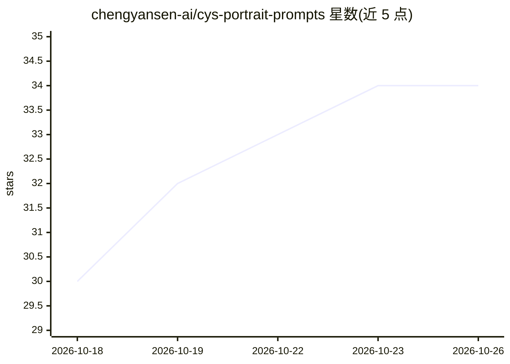

# chengyansen-ai/cys-portrait-prompts

⭐ 34 · Python · MIT · 推送 2026-08-27 · [GitHub](https://github.com/chengyansen-ai/cys-portrait-prompts) · 个人维护 · 中文 README

**中文 9 段式人像提示词模板库与批量生成器，面向文生图用户**

面向人像文生图的中文提示词工程资源库：将人像提示词拆为固定顺序的 9 个段落（人物/面容/妆容/身材/装饰/动作/服装/环境/摄像），前 4 段为可复用的真实感内核。仓库包含 SKILL.md 技能本体、风格预设与多类专业词库参考文件、以及仅用 Python 标准库的批量生成器（全身照与上半身中景照两版本），可一次生成千条级提示词并按服装/饰品/鞋履/背景四类协调匹配。模板适配 ComfyUI/Krea2/GPT Image 2，可作为技能加载至 Claude 等 agent。v2.0 已移除旧版硬约束与自动校验。

## 筛选速览

| 维度 | 判定 | 备注 |
|---|---|---|
| AI 角色 | `ai-knowledge` | 知识聚合/清单类 |
| 许可风险 | `permissive` | MIT |
| 部署形态 | `None` |  |
| 模型依赖 | — | README 未给出锁定关系 |
| 硬件要求 | — | 无带数字的原话,不猜 |
| 安装摩擦 | `low` | 无编译、无系统依赖或容器化 |
| 成熟度 | — | 结构信号不足 |

## 能力要点

- 9 段固定顺序模板，前 4 段真实感内核跨图复用
- 国风 10 类 + 现代/海外 20+ 种风格预设
- Python 标准库批量生成器，支持千条级生成与唯一性自测
- 模板适配 ComfyUI / Krea2 / GPT Image 2，可作为技能加载至 Claude 等 agent

## 适用场景

- 写文生图人像提示词时套用结构化模板，避免每次从零写
- 批量产出服装/饰品/鞋履/背景协调匹配的人像提示词
- 为 AI agent 添加人像提示词生成技能

## 场景标签

`提示工程` · 领域:Agent 开发

## 证据(README 行号)

> L22: - `SKILL.md`：技能本体，定义 9 段式模板、双版本构图、风格调用方式与工作流；
> L24: - `scripts/`：千条级批量提示词生成器与自测脚本；
> L79: - WorkBuddy / Claude / Codex 等：把本仓库目录放入对应 `skills/` 目录即可调用；

## 星数曲线

2026-10-18 30 → 2026-10-26 34（+4）

---
*卡片 v1 · prompt 1.4 · 生成 2026-10-25 · 置信度 high · 依据 README sha `e296ecfa38e2` · [字段定义](../../DATASET.md)*
