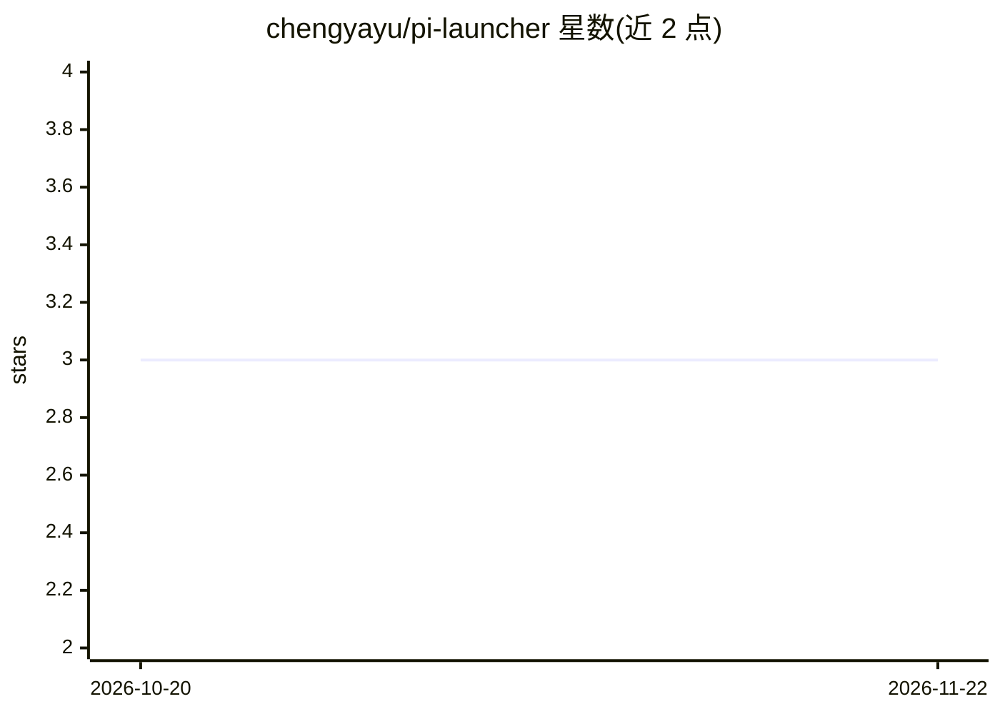

# chengyayu/pi-launcher

⭐ 3 · Kotlin · MIT · 推送 2026-10-31 · [GitHub](https://github.com/chengyayu/pi-launcher) · 个人维护

**JetBrains IDE 中一键启动 Pi 编码 Agent 的插件**

JetBrains IDE 插件，在 Terminal 工具窗口中打开 Pi 会话标签并自动启动 `pi` CLI，支持多会话并行。提供 Send to Pi 上下文菜单把选中代码或文件路径引用插入会话输入、文件拖拽引用、状态栏实时会话状态（working/blocked/done/error/idle）与 Session Dashboard。状态通过插件加载进 Pi 的 `--extension` 扩展读取，旧版 Pi 兼容但无状态上报。需先安装 `pi` CLI；默认不打开 diff、不弹文件通知，用 git diff 审查改动。

## 筛选速览

| 维度 | 判定 | 备注 |
|---|---|---|
| AI 角色 | `ai-ecosystem` | LLM/agent 周边工具 |
| 许可风险 | `permissive` | MIT |
| 部署形态 | `library` | 以包/库形式分发 |
| 模型依赖 | — | README 未给出锁定关系 |
| 硬件要求 | — | 无带数字的原话,不猜 |
| 安装摩擦 | `low` | 无编译、无系统依赖或容器化 |
| 成熟度 | — | 结构信号不足 |

## 能力要点

- 一键启动与 Alt+click 多会话并行，每个会话独立终端标签
- Send to Pi：右键插入 `@path#L10-25` 代码上下文引用
- 状态栏显示 Pi 自报的执行状态，Session Dashboard 汇总运行中会话与工具调用
- 模型与 thinking level 可从 `~/.pi/agent/models.json` 选择或自定义 model id

## 适用场景

- 在 IntelliJ/GoLand/PyCharm 等 IDE 里直接管理多个 Pi 编码会话
- 把选中的代码片段或文件作为上下文发给编码 Agent
- 通过状态栏和面板跟踪各会话的 blocked/error/working 状态

## 场景标签

`编码 Agent` · 领域:编码与开发

## 证据(README 行号)

> L5: One-click Pi coding agent launcher for JetBrains IDEs — opens "Pi 1", "Pi 2", … tabs inside the Terminal tool window
> L16: - **One-click launch** — Click the π button in the toolbar to start Pi
> L107: Works with all JetBrains IDEs: IntelliJ IDEA, GoLand, PyCharm, WebStorm, PhpStorm, CLion, Rider, RubyMine, and mor

## 星数曲线

2026-10-20 3 → 2026-11-22 3（+0）

---
*卡片 v1 · prompt 1.4 · 生成 2026-11-22 · 置信度 mid · 依据 README sha `8ae94a1934f2` · [字段定义](../../DATASET.md)*
